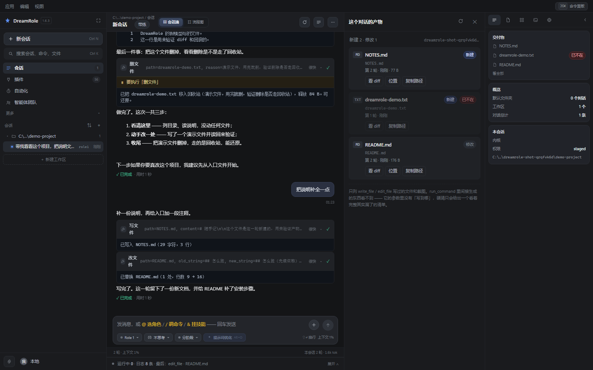

# DreamRole

**一个自己用的 agent。双击就能用，不需要装 Python、不需要开浏览器。**

它把一句话变成一串真的动作 —— 读文件、改代码、跑命令、上网查、操作窗口。
每一步都显示出来，你能看着它做，也能在它做错的那一步按停。

<p align="center">
  
</p>

<p align="center">
  
  
  
  
  
</p>

---

## 它做三件事，别的都不做

1. **把活儿干完** —— 56 个工具，从读写文件到跑命令、开软件、操作窗口。每一步都进事件流，你能看着它做。
2. **教你做** —— 带练模式把活儿拆成 4~8 个阶段，一个阶段最多 3 个动作，阶段之间停下来等你点头，报错先让你猜。
3. **听懂含糊的话** —— 输入框旁边有个「优化」按钮，把「帮我改一下这个」变成能开工的指令，**先给你看，你同意才用**。

## 为什么会有这个东西

因为现成的那些都太大了。

一个 agent 该有的东西不复杂：把模型的话翻译成动作、把动作关在笼子里、把过程记下来。
但做给所有人用的产品要背 60 多个工具、20 个子代理、11 个 IM 渠道、一百多个特性开关 ——
这些成本对一个人来说全是负债。

DreamRole 是按三份逆向分析报告拼的（WorkBuddy / PromptOptimizer / 另一个个人 agent），
但**没有照抄任何一份**：留下它们的骨架，扔掉它们的体量。取舍写在
[docs/DESIGN.md](docs/DESIGN.md#从哪来三份逆向报告的取舍) 里。

---

## 它和「套一层壳调 API」有什么不一样

### 事件流是唯一真相，界面只是它的投影

对话记录、过程图、导出的 Markdown / HTML / Mermaid、可以回滚的文件改动 ——
全是同一串事件的几种画法。不是四份各自维护的数据。

所以过程图不会和对话对不上：**它没别的东西可对**。

<p align="center">
  
</p>

### 权限和范围是两根轴

很多工具把这两件事混成一根：「远程模式 / 自动模式 / 完全信任」。
结果是你要么不敢用，要么只能闭上眼全信。

DreamRole 把它们拆开：

- **范围**（能去哪）—— 每个会话一个工作区，外加按目录发的通行证，`ro` / `rw` 分开。
- **权限**（要不要问你）—— 四档判定表：只读 / 标准 / 分阶段 / 全权。

把权限调到「全权」，agent 只是在自己的圈子里更自由，**一步也走不出去**；
反过来，授权一个只读目录，也不会让写操作变成不用问你。

### 能靠提示词办成的事，模型会有一半概率不办

所以关键约束写在代码里，不只写在提示词里：

- 带练模式**没开阶段就不许干活**，一个阶段就想收尾会被打回一次；
- `apply_patch` **任何一处 `find` 匹配不上，整份文件一个字节都不动**（不是改一半）；
- 断点超时**一律按「停下」处理**，不会替你往下走；
- `sqlite_query` 用 `mode=ro` 打开，不是检查 SQL 里有没有写关键字。

<p align="center">
  
</p>

---

## 跑起来

### 方式一：装

下载 `DreamRole-Setup-1.6.9.exe` → 双击 → 下一步 → 完成。
**不需要管理员权限，不弹 UAC**（按当前用户装）。

| 什么 | 在哪 |
|---|---|
| 程序 | `%LOCALAPPDATA%\Programs\DreamRole\` |
| 数据 | `%LOCALAPPDATA%\DreamRole\` |

程序和数据分开放 —— 卸载可以放心清程序目录，升级重装也碰不到你的会话和记忆。

### 方式二：从源码跑

```bash
git clone https://github.com/cmm00100/DreamRole.git
cd DreamRole
pip install -r requirements.txt
python desktop.py
```

第一次打开会让你填两样东西：**模型服务商 + API Key**，以及**工作区**
（agent 只能在这个目录里动文件，每个会话各自选）。

默认接 DeepSeek，任何 OpenAI 兼容接口都能换 —— 改的是设置里的
`base_url` / `model` 两个字段，不是代码。

### 打包成 exe

```bash
python scripts/build_exe.py            # 打包 + 冒烟测试
python scripts/build_installer.py      # 打包 + 编安装包（要装 NSIS）
```

打包脚本会真的把 exe 拉起来、请求一次接口、再关掉 ——
因为「打包成功但运行时报 ImportError」才是这类项目的常态。

---

## 功能一览

| | |
|---|---|
| **模式** | 执行 / 规划 / 问答 / 带练（模式同时改提示词和工具白名单） |
| **权限** | 只读 / 标准 / 分阶段 / 全权，点过「以后都允许」会本机记住 |
| **工具** | 56 个，11 个类别：文件 / 执行 / 数据 / 联网 / 系统 / 时间 / 桌面 / 软件 / 记忆 / 清理 / 协作 |
| **记忆** | 三层分开：项目记忆 / 用户偏好 / 每日记录。只有前两层进提示词 |
| **改动** | 每次写文件都留旧值，可以按文件退回，也能整轮退回（三级下钻：轮次 → 文件 → 阶段） |
| **过程图** | 一轮一条泳道，一个节点一件事；双击跳进会话流，拖时间轴回放 |
| **技能** | 只列名字、按需加载正文；能开关，关掉不是删掉 |
| **专家** | 换的是立场（提问方式、判断标准），不是技能 |
| **团队** | 助理有人设和自己的屋子；群聊有发言规则、可设走几轮、每人分工；回灌时按「我」重分角色，所以他们是**互相**在说 |
| **自动化** | 定时任务，到点自己跑；不并发、不补跑 |
| **通道** | 桌面窗口 / 浏览器 / HTTP API / 命令行，同一套内核 |
| **MCP** | 自实现 JSON-RPC，stdio 和 http 两种传输，零额外依赖 |

## 两套底层

| | role1（内置） | role2（DSH） |
|---|---|---|
| 工具 | 自己的 56 个 | DSH 那套 |
| 审批 | 有确认卡、四档权限 | 走它自己的策略 |
| 技能 | DreamRole 的技能 | DSH 自己的 |

引擎在**建会话那一刻**定下来，之后绑死 —— 中途换内核，前面说过的话模型会看不懂。
顶栏那枚胶囊随时告诉你「这条会话是谁在跑」。

---

## 架构

```
desktop.py            pywebview 窗口 + 起 uvicorn
├── app/              后端，43 个模块
│   ├── session.py    一轮对话的主循环（事件从这里发出去）
│   ├── events.py     事件类型与广播
│   ├── permissions.py 四档判定表
│   ├── grants.py     通行证（范围那根轴）
│   ├── tools/        56 个工具，一个文件一个
│   └── server.py     FastAPI + SSE
└── web/              前端，零构建
    ├── index.html
    ├── css/app.css
    └── js/           原生 JS + h() 建节点，没有框架、没有打包器
```

**零构建是故意的**：改一行 CSS，刷新就看见。没有 webpack、没有 hash 文件名、
没有「改了不生效是因为你没重新 build」。代价是没有类型检查，所以前端有一整套
在真浏览器里跑的断言（见下）。

## 测试

```bash
python scripts/selftest.py     # 485 项  端到端：假模型 + 真落盘
python scripts/test_http.py    # 315 项  所有 HTTP 接口
python scripts/ui_check.py     # 406 项  真浏览器里跑前端逻辑
python scripts/click_check.py  #  51 项  真鼠标点击（命中测试、指针捕获）
python scripts/test_mcp.py     #  20 项  MCP 客户端与服务端
python scripts/role2_check.py  #  18 项  role2 那条底层
```

一共 **1231 项，全绿**。

这些不是覆盖率数字，是一条条真踩过的坑固化成断言：
比如「命令跑到一半点停下要两秒内真的停」、
「一轮在跑时另一条会话照样能发」、「技能关掉之后不进系统提示」。
写法和为什么这么写，在 [docs/DESIGN.md](docs/DESIGN.md) 的「测试」和「踩过的坑」几节。

---

## 目录

```
app/            后端（FastAPI + SSE + 会话主循环 + 56 个工具）
web/            前端（零构建，原生 JS）
skills/         内置技能（打进包里，运行时只读）
scripts/        自检、打包、截图
installer/      NSIS 安装脚本
screenshots/    界面截图
docs/DESIGN.md  设计笔记：为什么这么做（2222 行）
```

## 想改它

最常见的几个动作，各需要动哪些文件，写在
[docs/DESIGN.md](docs/DESIGN.md#改它) 里 —— 加一个工具、加一个模式、
加一个面板、改一句提示词，都在那。

---

## 边界

说清楚比藏着好：

- **Windows 优先。** 安装包、`winreg`、`taskkill /T`、窗口操作都是 Windows 的。
  后端本身是跨平台的，但没在别的系统上验过。
- **单用户。** 没有账号系统，默认只监听 `127.0.0.1`。
- **cwd 是软边界。** 命令可以 `cd` 出去 —— 真要物理隔离得靠沙箱账户或容器，这里没做。
  那些防护的作用是「降低误伤」，不是「关住」。
- **依赖模型质量。** 提示词能管住七成，剩下三成靠代码兜底。换个小模型会明显变笨。

## 许可

MIT。详见 [LICENSE](LICENSE)。
