# DreamRole

> 这是 DreamRole 的设计笔记，记的是「为什么这么做」而不只是「做了什么」。
> 2222 行，是开发和踩坑过程里一条条攒下来的。
>
> 想先跑起来，回 [README](../README.md)；想改代码，看「[改它](DESIGN.md#改它)」那一节。

---

一个自己用的 agent。双击 `DreamRole.exe` 就能用，不需要装 Python、不需要开浏览器。

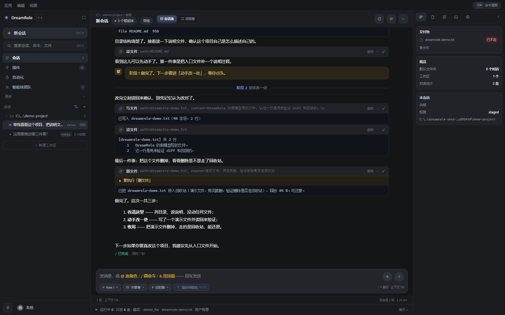
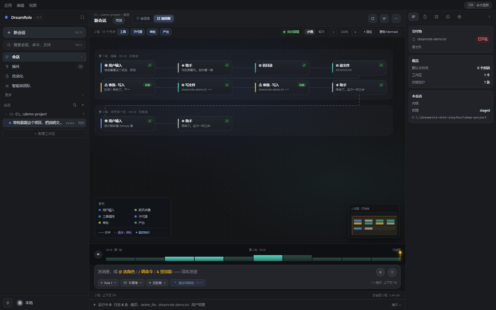

---

## 它是什么

DreamRole 做三件事，别的都不做：

1. **把一句话变成一串真的动作** —— 读文件、改代码、跑命令、上网查、操作窗口。每一步都显示出来，你能看着它做。
2. **教你做** —— 教学模式会把活儿拆成 4~8 个阶段，每个阶段之间停下来等你点头，一次只讲一个概念。
3. **听懂你含糊的要求** —— 输入框旁边有个「优化」按钮，按一下把「帮我改一下这个」变成一条能开工的指令，**先给你看，你同意才用**。

它的世界观只有一句：**事件流是唯一真相，界面是它的投影**。
过程图、对话记录、导出的 Markdown / HTML / Mermaid、可以回滚的文件改动，
全都是同一串事件的几种画法。

---

## 怎么跑起来

### 装一下（推荐）

```
DreamRole-Setup-1.6.9.exe
```

双击 →「下一步」→「安装」→「完成」，装完桌面上就有快捷方式，开始菜单里也有。
**不需要管理员权限，不弹 UAC**，因为它是按当前用户装的：

| 什么 | 在哪 |
|---|---|
| 程序 | `%LOCALAPPDATA%\Programs\DreamRole\`（和 VS Code 用户版一个位置） |
| 数据 | `%LOCALAPPDATA%\DreamRole\` |
| 卸载 | 设置 →「应用」里找 DreamRole，或开始菜单里的「卸载 DreamRole」 |

程序和数据**分开放**，这不是洁癖。放在一起的话，「卸载」就只有两个都不好的选项：
要么连几十条会话、记忆和配置一起删掉，要么留下一个删不干净的目录。分开之后，
卸载可以放心清空程序目录，升级重装也碰不到数据；卸载时它会单独问一句
「要不要连数据一起删」，默认是**保留**（手滑一次不该把记忆干掉）。

程序靠安装目录里那个 `install.marker` 判断自己是安装版。没有这个标记，
它就按绿色版处理 —— 数据放 exe 同级的 `data\` 里。

### 用打包好的 exe（绿色版）

```
dist\DreamRole.exe
```

不装，拷走就能带走，数据在 exe 同级的 `data\` 里。适合放 U 盘、或者同时留几个版本对比。

第一次打开会让你选两样东西：**模型服务商 + API Key**，以及**工作区**（agent 只能在这个目录里动文件）。

工作区是**每个会话各自的**，而且必须由你选。没选之前对话是走不通的 ——
见下面「工作区」一节，那里说了为什么不做「上次那个目录」的默认值。

数据存在哪（按优先级）：

1. 环境变量 `DREAMROLE_DATA_DIR` 指定的目录
2. 源码模式：项目里的 `.data\`
3. **安装版**：`%LOCALAPPDATA%\DreamRole\`
4. 绿色版：exe 同级的 `data\`（写不进去就退到第 3 条）

> 从 Aster 改名过来时留下的东西不会丢：旧的环境变量 `ASTER_*` 会自动顶到
> `DREAMROLE_*`（新名字优先），`%LOCALAPPDATA%\Aster\` 里的配置会在新目录还空着
> 的时候被复制过来（只复制，旧目录原样留着）。

### 从源码跑

```bash
python desktop.py            # 开窗口
python desktop.py --no-window   # 只起服务，用浏览器打开
```

### 打 exe

```bash
python scripts/build_exe.py            # 打包 + 冒烟测试
python scripts/build_exe.py --onedir   # 目录版（启动更快）
```

产物在 `dist\DreamRole.exe`，约 56 MB。打完之后脚本会真的把 exe 拉起来、请求一次接口、再关掉 —— 因为「打包成功但运行时报 ImportError」才是这类项目的常态。

### 打安装包

```bash
python scripts/build_installer.py                 # 打包 exe + 编安装包
python scripts/build_installer.py --skip-exe      # 只重编安装包
python scripts/build_installer.py --install       # 编完静默装一遍，逐项验
```

产物是项目根目录下的 `DreamRole-Setup-<版本>.exe`。需要 NSIS
（`winget install NSIS.NSIS`，默认装在 `C:\Program Files (x86)\NSIS`；
装在别处就设环境变量 `NSIS_MAKENSIS`）。

安装脚本在 `installer\dreamrole.nsi`。手敲编译时必须带 `/INPUTCHARSET UTF8`：
脚本里全是中文，NSIS 默认按系统 ANSI（GBK）读，编出来是一屏乱码，**而且编译过程不报错**。

`--install` 那一步不是装饰。它会真的静默装一遍，然后检查桌面快捷方式有没有出现、
控制面板里有没有记录、装好的 exe 能不能跑、版本号对不对，以及**数据有没有跑到
程序目录里去**（跑进去就说明 `install.marker` 那套判断没生效）。
「安装包编出来了」和「安装包能用」是两件完全不同的事。

### 双击之后到底发生了什么

这条链路每一步都可能断，而且断了以后的**现象几乎一样**（「什么也没发生」），所以写在这里：

```
准备数据目录 → 起 HTTP 服务（等端口真的能连上）→ 开窗口
   → 页面加载 → 页面回执「脚本跑起来了」→ 界面渲染完 → 回执「ui=1」
                                    ↘ 8 秒内没等到 → 自动用浏览器窗口打开
```

**页面回执**是这套东西的关键。只看「窗口开出来了」是不够的：窗口好好地开着、里面一片背景色，所有检查都会点头，用户只能对着空气发呆。所以页面自己回话，外壳等不到就换条路（`msedge --app=...`，一个没有地址栏和标签页的窗口，看起来还是这个软件）。

出了问题先看日志：**`data\logs\dreamrole.log`**（`data` 目录见上面「数据存在哪」）。里面按顺序记着服务端口、窗口句柄和矩形、回执、以及界面报上来的异常 —— 页面出错时会把错误原文回传给服务端写进这个文件，因为窗口程序没有控制台，用户也没法按 F12。

界面出错时看到什么，分两种情况 —— 这条分界是按「界面有没有在用」划的：

| 什么时候 | 画什么 | 为什么 |
|---|---|---|
| 启动阶段（`bootstrap` 没走完） | 整页深红，写清错误原文 | 这时候本来就没有界面，宁可难看也要让人截得到图 |
| 运行阶段（`__dreamroleReady` 之后） | 顶部一条窄错误带，可展开看栈、可关掉 | 界面是好的，只是某一下操作失败了 |

早先只有第一种。代价是：**点一下工具开关，整个界面被一张报错页盖住** ——
真实原因见下面「`await` 之后 `event.currentTarget` 就是 null」，但就算根因修好了，
这条兜底也不该那样工作。因为一个按钮出错就把界面盖成报错页，等于让用户以为
整个软件坏了，那比错误本身更糟。错误带不自动消失（自动消失的是提示，不是错误），
也不遮内容 —— 它是 `.app` 这个竖向 flex 的第一行，把内容挤下去而不是盖上去。

---

## 界面

```
┌───────────────────────────────────────────────────────────────┐
│ 应用 编辑 视图                                        ⌘K  ○ ○ ○ │
├──────────────┬────────────────────────────────────────────────┤
│ ◈ DreamRole  │ 工作区 / 会话        ▤ 会话流  ⌗ 流程图   ◎ 实时 │
│ ＋ 新会话 ⌘N │────────────────────────────────────────────────┤
│ ⌕ 搜索…      │                                                │
│ 会话      12 │   对话流  或  流程图（一轮一条泳道 + 节点 + 线）│
│ 插件      56 │                                                │
│ 自动化     2 │                                                │
│ 智能体团队 3 │                                                │
│ 更多 ▸       │                                                │
│              │                                                │
│ C://项目      │                                                │
│  · 一条会话  │                                                │
│  · 又一条    │                                                │
├──────────────┴────────────────────────────────────────────────┤
│ [ ＋ ] 说一句话…                                    [发送]    │
│ Role 1 · 不思考 · 标准 · 提示词优化              ⇧↵ 换行      │
└───────────────────────────────────────────────────────────────┘
```

左栏是**一条竖列**，不是一个图标条加一列内容：

| 栏 | 干什么 | 快捷键 |
|---|---|---|
| 会话 | 这条会话的历史列表；右键或悬停「⋯」可置顶 / 改名 / 归档 / 删除 | `Ctrl+1` |
| 插件 | **插件**（工具开关）、**Skill**、**专家**、**连接器**四格合一 —— 一件事的三种形态 | `Ctrl+2` |
| 自动化 | 定时任务：到点自己跑 | `Ctrl+3` |
| 智能体团队 | 助理与群聊：有人设、有自己的屋子 | `Ctrl+4` |
| 更多 ▸ | 改动 / 软件 / 记忆 / 安全 / 运行时 / 用量，点一下展开在同一条列里 | — |

搜索不占一行：上面那个搜索框就是它（点开是 `Ctrl+K` 命令面板）。
设置走底部那颗齿轮 —— 一天点不了几次，占一格太贵。
`Ctrl+1`~`Ctrl+4` 是那四行一级导航；「更多」里的六项没有快捷键，
按顺序记住位置比记序号快（它们就排在那四行下面，一直是同一片地方）。

**为什么是一列而不是「图标条 + 内容列」**：图标条只回答「去哪」、内容列只回答
「这一栏里有什么」，两件事分开画，看着是清楚的；但十四栏全挤进一条 288px 的列里，
会话树就没地方了 —— 而会话树是这一栏里用得最多的东西。所以一级导航只放四行，
剩下的收进「更多」，位置不变、不另开一层。

内容列的宽度按栏变：列表型的 236px，表单型的（设置）340px。硬压成一样宽，
输入框会被挤成一条缝。表单一多的栏右上角有个「放宽」按钮，按一下多给 150px。

右上那个按钮 = **这个对话的产物**（见下）。它原来开的是「工具 / 技能 / 设置」抽屉 ——
那三样左栏本来就有，两个入口指向同一批内容，只会让人先想「我该从哪边进」。
右侧抽屉里是同一套内容的宽版 —— 一处实现，两处宿主。

对话页右上角有 **重试** 和 **导出**。鼠标移到你自己说过的那句话上，
会浮出 **改一下 / 分叉 / 复制** 三个按钮。

输入框支持 `@` 带文件：打 `@` 会列出工作目录里的东西，方向键选、Enter 确认。
选中的文件内容会被**提前读好塞进上下文**，不用模型再调一次工具去读。
左边的「技能」按钮（`Alt+S`）是同一个思路，只是带的是技能而不是文件。

输入框上方那条**待办**是可以收起来的（点标题或 `Alt+T`），右边还有一个 `×` 把它整块先藏掉。
默认行为是「全部做完就自动收成一行」—— 那时候它只剩 `6/6` 这一个信息，
再占六行就是纯占地方，把输入框往上顶。手动开合过之后，程序就不再替你决定：
你收着，新进度只会更新数字和那条进度条，不会把它顶开。

`Ctrl+K` 打开命令面板：切会话、切模式、切左栏、开面板、导出、重试，全在一个输入框里。
`Ctrl+1`~`Ctrl+4` 直接切左栏那四行。`Alt+R` 重跑上一句，`Alt+O` 优化这句话，`Alt+S` 挑技能，`Alt+T` 收放待办。

### 动效

动画只干一件事：**解释刚才发生了什么**。不表演，不改布局，能关掉。

- 消息、工具卡、闸门、待办各有一段短入场（.2 秒上下），只为告诉你「这是新的」。
- 阶段分隔的横线从中间长出来 —— 它是一道分界，不该像消息那样飘进来。
- 工具卡在跑的时候左边有一道流动的光，跑完就停。没有它，一个跑了十秒的命令和一条卡死的事件看起来一模一样。
- 工具输出折叠用 `max-height` 过渡，展开时像抽出抽屉。
- 闸门卡片边框缓慢呼吸（不是闪烁 —— 闪烁是催命，呼吸只是说「我在」）。
- 权限灯在「只读」和「全权」两种状态下脉冲，因为这两种最需要你意识到。
- 勾掉待办时方框会弹一下，进度条自己会长。
- 标签页的下划线从中间向两边张开，比整块变色精确。
- 过程图上，节点入场是「略小 + 略下 + 透明 → 到位」；连线用 `stroke-dashoffset` 从 1 走到 0 长出来；
  正在跑的那个节点有两圈错开一秒的光晕往外扩，连出去的那条线上跑一颗光点；打开的那个亮蓝描边。
- 底部那条时间轴里，正在跑的那根柱子是蓝的、会长一下 —— 它是「现在」在整段里的位置。
- 卡片入场用 `animation-fill-mode: backwards` 而不是 `both`：动画没跑完（截图、后台标签页、
  被打断的合成）时，元素回到正常样式，而不是被最后一帧按在透明态。「东西不见了」是最难查的一种 bug。

系统设了「减少动态效果」（`prefers-reduced-motion: reduce`）时，上面全部静止，
过程图的镜头补间也直接跳终点 —— 不是变成更慢的动画，是不动。

---

## 过程图：一轮一条泳道，一个节点一件事


从 `会话流` 切到 `流程图`（中栏头上那两格），同一份事件流换一种看法：
**横着看是「这一轮做了哪几步」，竖着看是「一共几轮」**。

- **一条泳道 = 你说的一句话**。道口写着 `第 2 轮 · 阶段名 · 14:05 · 已完成 / 进行中`。
  为什么按轮分而不是按阶段分列：读图的人问的是「这一轮它干了什么」，
  而不是「所有轮的第三步横向比起来怎么样」。
- **一个节点 = 一件事**，172×46，左边一条 3px 色条就是类型：用户（蓝）、助手（灰）、
  工具（青）、子代理（紫）、审批（黄）、产出（绿）。标题一行、副行一行，
  全文在右边「节点详情」里看 —— 画布上堆字，图就没了。
- **连线**：同一排是一条横线；换排、换轮走一条「总线」（往下到两条道之间的缝，
  横过去，再下到下一张的顶边）。跨轮那条是紫色虚线：**递进**和**同一条道里往前走**
  是两种关系，画成一个样子就分不出来了。
- **正在跑的那一步**有光晕，它连出去的线是流动的蓝线，线上跑一颗光点。
  整张图只有这一处在动 —— 全都动起来等于没有重点。
- **工具条左边是筛选**：工具 / 子代理 / 审批 / 产出，关掉哪一类，那一类节点就真不画
  （连同它的连线一起让位），不是画淡。画淡了图还是一样满，「筛掉」就没意义了。
- **底部那条时间轴**：一个节点一根柱子，高的是「这一步更重」。
  它不承担精确计时（事件流里没有耗时字段），承担的是这段对话的节奏 ——
  柱子密集的地方，就是它真正在干活的地方。左边那颗键暂停流光。
- **右栏「节点详情」**（下图）：类型、第几轮、几个动作、几条事件，然后是这条节点里的全部事件。
  动作的 `arguments` 原样铺出来（JSON 缩进）—— 「它到底拿什么参数去做的」
  是这种情况唯一能查的东西，概括成一句话就等于查不了。底部一键回到会话流里那一条。

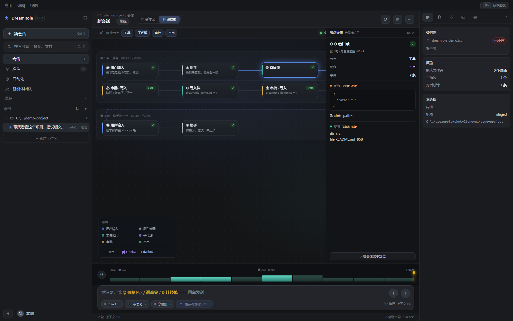

---

## 左栏：一列到底，一棵树

左栏以前是「图标条 + 内容列」两段：左边一排没字的按钮，右边一列内容。结果是
「这软件到底有哪些功能」得靠悬停一个个认，同一件事还有两个入口。现在是一条竖列：

```
◇ DreamRole  1.6.9                      ← 品牌 + 版本 + 这一栏的宽度
＋ 新会话                      Ctrl N
⌕ 搜索会话、命令、文件           Ctrl K
会话 12 / 搜索 / 插件 58 / 自动化 3 / 助理 2 / 改动 9 / 更多 ▾
会话                                    ⇅ ＋
  ★ 置顶                          1
  ⌂ 默认                          2        ← 没选过工作区的都在这里
     · AI 助手与 WorkBuddy 对比   role1  6 小时前
  📁 demo-project                 4
     · 主界面重设计 v2            role2  3 分钟前
＋ 新建工作区
⚙  我 · 本地
```

**「会话」是导航第一行。** 它曾经被省掉，理由是「树就长在导航下面，何必再点一次」。
结果点了「技能」之后树被面板顶掉，而没有任何一行能点回去 —— 那条路只有一个走法，叫重启软件。

**只有一棵树。** 以前是「工作区列表」+「会话列表」两摊，同一条会话在两处各出现一次，
而且工作区那摊是另存的，点进去还可能是空的。现在一棵：顶上「默认」装没选过目录的会话，
下面按工作区分组。**分组是从会话自己记的目录算出来的**，不另存一张表 ——
另存一份的话，迟早出现「列表里有这个工作区、点进去空着」这种没人维护的空壳。

**每一行只占一行。** 两行一条的时候，288px 宽的栏里同时放下「标题 / 路径 / 时间 / 标签」
是不可能的，最后一定是 `主界面重…` 加一行什么也说明不了的灰字。压成一行之后，
标题独占剩下的宽度，反而读得出来。行首那颗点同时说四件事：当前（蓝）、在跑（绿脉动）、
归档（淡）、以及 ROLE 标签说的是哪个内核。

**工作区的「⋯」里没有删除。** 「删工作区连带删文件夹和全部对话」是一条真会让人丢掉整个项目的路，
而这棵树只是左栏的一层展示。替代是「从列表里隐藏」：只影响这一栏，磁盘和会话都不动，
同一个菜单里随时放得回来。

### 对话页的五层

规则一句话：**扫一眼就能分出这是哪一类**。

| 层 | 视觉手段 |
|---|---|
| 用户 | 右对齐浅蓝气泡 + 时间；「改一下 / 分叉 / 复制」悬停才出 |
| 助手正文 | 左对齐、**不套气泡**、行高 1.8、最宽 92% |
| 推理 | 压成一行 `✳ 已思考 8 秒 · 展开`（流式时显示 `正在想… N 字`） |
| 工具 | 单行卡：图标 + 名称 + 参数摘要（等宽）+ 耗时 + ✓；点开看输出 |
| 轮次 | 一句说完给一行 `✓ 已完成 · 用时 8 秒` |

之前这些全是「灰色小字 + 圆角块」，层级塌成一层：用户、回答、推理、工具、系统提示长得一样。

两个细节值得单独说：

- **助手正文去掉了气泡**。它本来就在左、已经是「它说的」那一侧，再包一层灰框，
  等于给每段话加一圈与内容无关的边；去掉之后行高才能放到 1.8，长段落才读得下去。
- **工具卡不再挂一个「做」字徽章**。一整屏下来十几个「做」，每个占 26px，读起来像一份填空题。
  一枚 11px 图标说同样的事，省下的宽度全给了参数摘要 —— 那才是用户要扫的东西。
  耗时记在**卡片自己身上**（`dataset.start`），不放在全局变量里：一条会话里几十个调用并发，
  放全局后开始的会被先开始的覆盖，算出来的耗时全是错的。

### 中栏头 / 右栏 / 输入区：三块各有主语

这三块以前都是「一条工具栏」—— 什么都塞得下，什么都不显眼。设计稿的做法是给每一块
一个主语，然后按主语排：

| 块 | 主语 | 排法 |
|---|---|---|
| 中栏头 | 这条会话 | 上一行面包屑「工作区 / 会话」（10px 灰），下一行标题（14px 600）+ 它身上挂的胶囊（几个智能体 / 计划走到哪 / 几个定时任务）+ 右侧三枚 28×28 方按钮（重试 / 导出 / 右栏开关） |
| 右栏 | 这一屏的产出 | 296px 常驻一列，顶上五枚图标（全部 / 交付物 / 计划 / 后台 / 概览）选「只看哪一类」，下面是卡片：交付物 → 计划·步骤 → 自动化 → 概览 → 本会话 |
| 输入区 | 这一句话 | 一个 12px 圆角框：第一行说话 + 技能 / 优化 / 发送三个圆按钮；第二行是**内核 / 思考档 / 权限**三枚胶囊；框外一条状态条（左边这一条会话的账，右边它挂在哪儿）；再往下是常驻的 34px 日志抽屉 |

三个决定值得单独写下来：

- **权限、内核、思考档从顶栏搬进输入框**。它们是「这句话在什么条件下发出去」，
  原来挂在右上角，改一句要先抬头再低头。搬到框下沿之后，改的东西和受影响的
  东西在同一处。
- **右栏是常驻的，不是抽屉**。产物和计划是要一边干活一边瞄的东西，点开看一眼
  再点回去，等于没有。抽屉（右上角那枚立方体）留着看完整的产物清单。
  每张卡只放这一屏真知道的东西：没有的整张不画 —— 摆一个「暂无数据」的
  空盒子比不画更像坏了。
- **收起永远配一个打开**。右栏收起后靠中栏头那枚方按钮再打开，两个方向都通；
  只能收不能开是最常见的坑。收起状态记在 `localStorage`，下次进来还是那样。

右栏顶上那排图标是「过滤器」不是「又一层导航」：点「计划」只留计划卡，
点「全部」都回来。选中的格子记在 state 里，否则每来一条事件，用户刚点的
「只看计划」就被弹回「全部」。

---

## 输入框旁边那个 ＋：八项，每一项都真的往框里塞东西

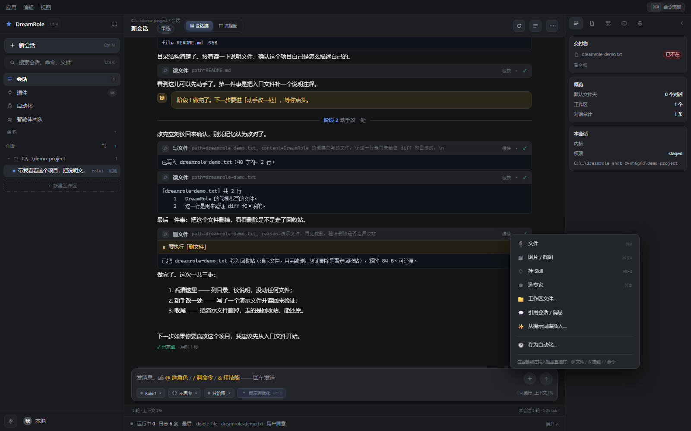

它原来只有四项，而且第一项「文件」点下去只是往输入框打一个 `@` —— 打完什么都没有，
用户以为坏了。现在的规则是：**菜单里的每一项都必须真的产出一段能发出去的文字**，
塞不进去的就不该摆在这儿。

| 项 | 快捷键 | 点了之后发生什么 |
|---|---|---|
| 文件 | `⌘U` | 打开**系统的选文件对话框**，选中之后把 `@文件名` 插进去 |
| 图片 / 截图 | `⌘⇧V` | 同上，但只筛图片，插的是 `@图片名` |
| 挂 Skill | `Alt+S` | 就地展开技能列表，点一个挂到这一轮 |
| 选专家 | `⌘@` | 切到专家栏 |
| 工作区文件… | — | 自己的选择器：面包屑 + 搜索，点一行引用一个文件 |
| 引用会话 / 消息 | — | 选一条旧会话 → 选一条问答 → 插成 `> 引自「标题」· 我：…` |
| 从提示词库插入… | — | 收藏过的话，搜一下、点「插入」 |
| 存为自动化… | — | 把输入框里这句话直接变成一条定时任务 |

三个实现上的讲究：

- **插进去的是相对路径**。`@` 引用由后端 `session._expand_refs` 展开，它是按
  `工作区 / 名字` 找文件的 —— 插绝对路径反而找不到。
- **前后按需补空格**。不补的话 `@a.txt` 会把前一个字吃掉（`看@a.txt` → `看@a.txt`
  看着没事，但 `看a.txt` 里那个字会被当成引用名的一部分）。
- **`＋` 只是可发现性入口**，不是唯一入口。八个快捷键都能直接在框里打出来，
  菜单解决的是「我不知道有这回事」。

### 塞进去之后：输入框上方那排 chip

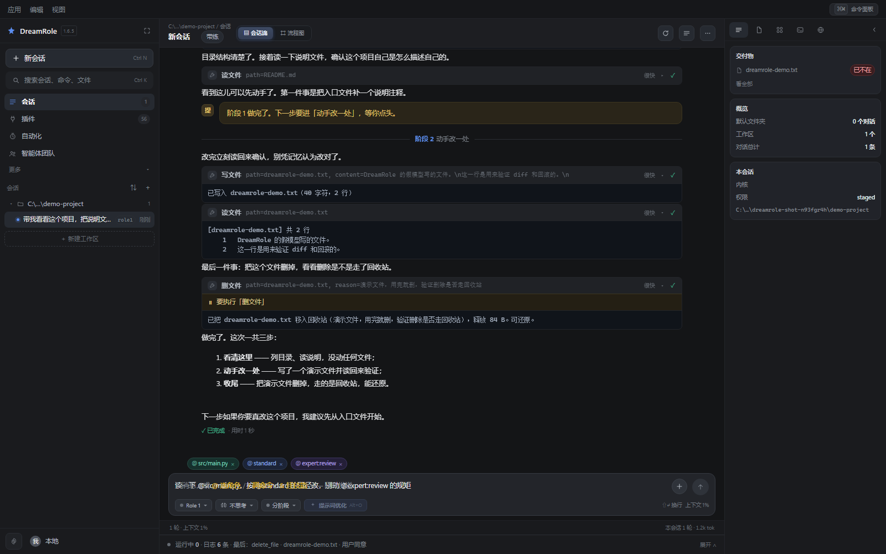

八项塞进去的都是 `@名字`。它会在输入框上方变成一枚彩色 chip：**蓝=角色、紫=专家、
青=文件**（同一句话里混着三种，颜色是唯一能一眼分开的办法）。点 `×` 就把那一处
`@名字` 从句子里摘掉 —— chip 和输入框里的文字是**同一份真相**，不存在「chip 删了
字还在」。

为什么不把输入框换成一串 chip 编辑器（很多 IM 那样）：那要把光标、撤销、
「粘贴一段带 @ 的话」全部重做一遍，而真正需要的只有两件事 —— 看清这一句点了谁、
点错了能一键摘掉。这两件事不需要换编辑器。

### 工作区文件选择器

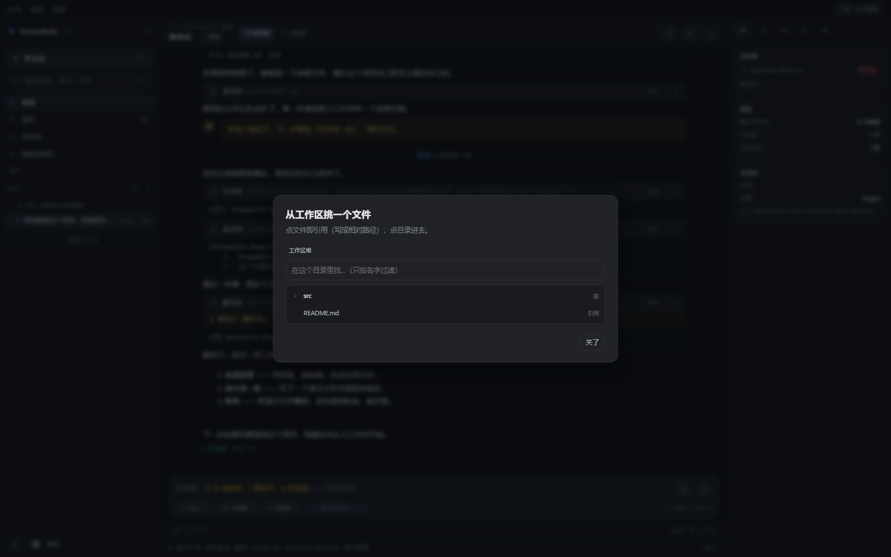

左边这一栏是「这一条会话能碰到的东西」，所以这个选择器只能在工作区里走：
面包屑一路点进去，`进` 是目录、`引用` 是文件。**它不给「浏览整台机器」** ——
那是工作区本身的边界，从这个弹窗绕过去，边界就白设了。

### 提示词库：收藏的是「这句话」，不是「模板系统」

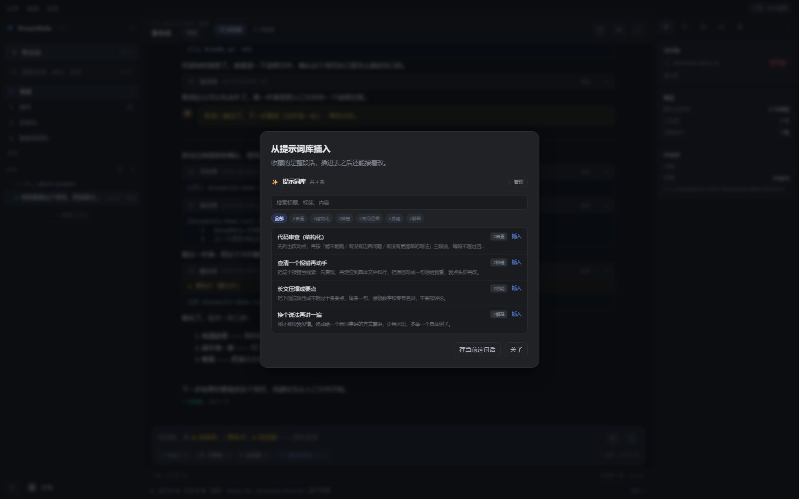

优化浮层右边那颗「存为收藏」把改好的那句话存下来，`＋` 菜单里的「从提示词库插入…」
把它取出来。只有三件事：标题、一句话说明、标签。没有变量、没有版本链 ——
版本链是「这一次改了几版」（在浮层里），收藏是「这几句我想留着」，
两件事混在一起会变成一个谁都不敢改的中间层。

上限 300 条。收藏夹的意义是「挑出来的」，不是「全都留着」。

---

## 插件页：一件事的三层，不再占四行导航

左栏原来有四行：专家 / 技能 / 工具 / 连接器。它们本来就是同一件事的三层 ——
**插件**（工具 + 连接器 MCP）让能力有手脚，**Skill** 说这类活怎么干，**专家** 决定谁来做。
摊成四行之后，左栏一半被它们占了，会话树只剩一小条。现在合成一页三格：

```
[插件 56] [Skill 2] [专家 5]        ← 每格带计数
[已启用工具 49/56] [连接器 0] [工具分组 11]
让能力有手脚：工具与连接器 MCP
（插件格：工具按「文件 / 执行 / 数据 / 联网…」分组折叠，下面接「连接器（MCP）」）
```

三个 id（`experts` / `skills` / `tools` / `connectors`）**没有删掉**：深链
`?section=skills`、命令面板、还有一堆 `Panels.open('skills')` 的老调用点都还按 id 走，
`Sidebar.show()` 会把它们路由到插件页并点亮对应的格。删 id 是省事的做法，
但那等于把所有入口一起打断。

内容**没有重写**：Skill 格和专家格直接就是原来那两个面板，只有「插件」格是新的组合。
重写一遍只会让「同一件事两套实现」再长出来，而后长出来的那一套永远少几个修过的坑。

## 自动化页：只画真的能跑的东西

设计稿那页有四类触发 —— 按时间 / 按事件 / 目标循环 / 手动。**按事件**还是没有：
那要挂文件监听和 webhook 端口，是三套新机制，不是三个选项框。剩下三类都通了：

- **按时间**：每天 / 每周的某个点
- **按间隔**：从现在起每 N 分钟（不是整点对齐）
- **手动**：不排班，存着这句话，点「试运行一次」才跑

摆假开关是最伤的一种做法。一个点了没反应的「按事件触发」，会让用户从这一处
开始不信任整页 —— 所以宁可只有三档。

页面给的是：

- 三个 tab：**自动化**（有哪些任务）/ **运行记录**（它们真跑过没有）/ **模板**（从一个起点开始）
- 顶部三个指标：启用中 / 已跑总次数 / 下次触发（只写 `10/25` 或 `00:46`，完整值在 title 上）
- 筛选条四档：全部 / 定时 / 间隔 / 已暂停，**每档带计数**（点进去才发现是空的，是白跑一趟）
- 卡片：频率图标（表盘 / 日历 / 循环）+ 名字 + 频率标签 + 开关 + 一句话任务 + 下次 / 已跑 / 工作区
  + 三个动作（看上次结果 / 暂停 / 删除，删除要二次确认）

暂停的任务不隐藏、只褪色 —— 它还在，只是现在不跑。做成「看不见」的话，用户会以为删掉了。

### 运行记录：回答「昨晚它到底跑了没有」

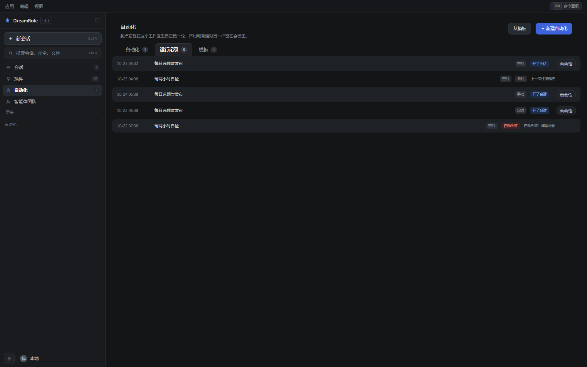

卡片上那个「已跑 12 次」只说明发生过，说不清是哪一次、跑出了哪条会话、为什么跳过。
所以每次**真的**开了一轮、被跳过、或者启动失败，都往 `state/schedule_runs.json`
写一行（上限 300 条）：

| 状态 | 什么意思 | 右边写着 |
|---|---|---|
| 开了会话（蓝） | 真的开了一条会话 | 「看会话」—— 点得回去 |
| 跳过（灰） | 没开 | 为什么：`上一次还没跑完` / `没有工作区` |
| 启动失败（红） | 开了但立刻炸了 | 异常原文 |

**不显示「耗时 / token」**：那要等会话真跑完才知道，而现在这一条只记到「开了一轮」。
摆一个恒为空的格子，比不摆更让人怀疑别处也是假的。

### 模板：四条真的会存进任务列表的起点

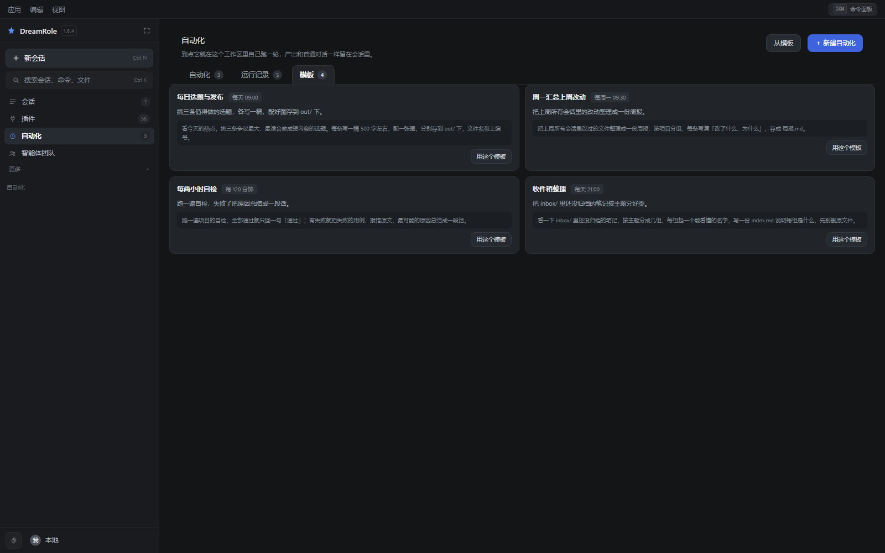

点「用这个模板」= 打开新建表单并填好触发方式和提示词。**工作区还得你自己选** ——
那是唯一一件它猜不出的事，猜错就是让它半夜在别人的目录里写东西。
省掉的是「想清楚要写什么」，不是「确认」。

### 新建表单：三段，因为这条表单填错没人看着

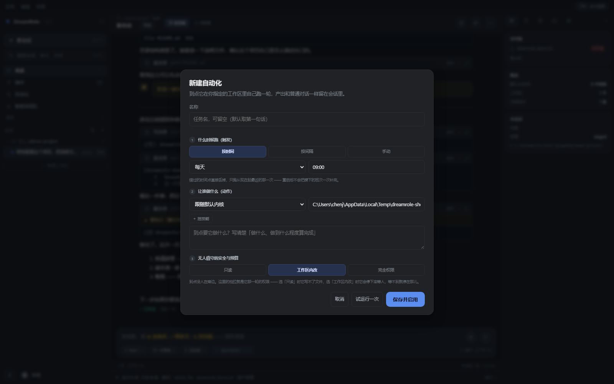

① 什么时候跑 ② 让谁做什么 ③ 无人值守的安全与预算。分段不是为了好看：
这条表单填错任何一格，后果都是「半夜自己跑、跑错地方」，而那时候旁边没人。

**表单里每一格都真的会生效**（`permission` / `engine` / `skills` 一路传到 `_fire()`
里那次 `session.create` 和 `start`）。少这三样的话，「到点自己跑」永远用默认档 ——
一个要改文件的任务会在半夜卡在审批上等到天亮，而用户以为自己设好了。

- 换触发方式，下面那行格子跟着换长相：按时间 = 每天/每周 + 时刻（+ 周几），
  按间隔 = 只有一个分钟格，手动 = 一个格子都没有。留一个当前用不上的空格子，
  用户就会去填它，然后奇怪为什么没生效。
- 技能是 chip：挂上是一枚绿的，点 `×` 拿掉；`＋ 挂技能` 在表单里就地展开一个小列表。
- 权限三档和主界面同一套（只读 / 工作区内改 / 完全权限），默认落中间那档 ——
  无人值守的任务默认给全权是不能接受的。
- 底部三个键：取消 / **试运行一次** / 保存并启用。试运行走的是和自动跑**同一条路**
  （同一个 `_fire`、同一把「不并发」的锁、同样开一条会话），否则它试的就不是那件事。

---

## 底部那条日志抽屉：34px 里的三件事

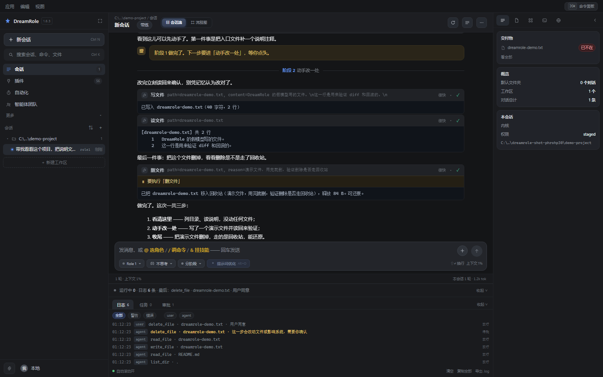

工具判定、定时任务、审批，这三件事一直在发生，但以前各自只在自己那一屏露一下脸，
跑完就消失。于是「刚才那一下到底放行了没有」只能靠翻对话流，翻不到就只剩猜。

设计稿把它做成一条**常驻 34px** 的抽屉。折叠态是有内容的 ——
`运行中 0 · 日志 6 条 · 最后：delete_file …`，左边那个点：绿=有东西在跑、红=刚有拒绝。
点一下展开，三个格：**日志 / 任务 / 审批**，每格带计数。

- **日志** = 审计链（`audit.jsonl`）。一行是「时分秒 · 谁 · 做了什么 · 对谁 · 判定」。
  判定三色：放行是灰的、等待/跳过是黄的、拒绝是红的。筛两行：
  级别（全部/警告/错误）+ 来源（就是数据里真的出现过的 actor，不写死）。
- **任务** = 定时任务，一行一条：下次时间 · 名字 · 频率 · 跑着/等待/已暂停。
- **审批** = 上面那些里 `gate` / `skip` / `deny` 的那几条。没有就是「没有需要你点头的事」。

数据全部来自现成接口（`/api/security` 的 entries + `/api/schedules`），
**没有为这个抽屉新造一份状态** —— 造了就会和真实现场对不上。

底部那排：自动滚动（新条目在最上面，跟随就按回顶部）、清空、复制全部、导出 `.log`。
「清空」要按两下：第一下变成「再点一次清空」，3 秒不动自己退回去。审计链是
「事后能证明没被动过」的东西，一下点没了就再也证明不了；但弹一个原生 confirm 又太重。

它挂在中栏最底下、**输入区下面**，不是夹在对话流和输入框之间 ——
放中间会读成「又一条工具栏」，还把「我说的话」和「它的回答」从中间断开。
面板页里它是藏着的（那几屏自己就是一整页，底下再挂一条会让人以为是页面的一部分）。

---

## 工作区：一个会话一个目录，没选就走不通

工作区就是这个会话的**主目录**：agent 默认只在这里读写文件，相对路径、产物、截图、
记忆都落在这儿。想让它顺手能碰别的地方，得在同一个弹窗里单独发一张「通行证」——
但**工作区永远是那个基准**，不是「随便哪个目录都算」。

它跟着会话走，不跟着程序走 —— 打开旧会话，回到的是那条会话当初选的目录。

**没选之前，对话是走不通的。** 这条在三个地方各拦一次：

| 层 | 表现 |
|---|---|
| 界面 | 对话区被一块说明挡着，发送键灰掉，顶栏胶囊变琥珀色并显示「未设置工作区」 |
| HTTP | `POST /api/session` 没有 `project` → 412；给没有工作区的会话发消息 → 412 |
| 会话 | `run_turn` 自己再判一次，条件不满足就只留一条提示，不调模型 |

为什么拦三次：前两层是「体验」，最后一层是**不变量**。只要有一处靠调用方自觉，
迟早会被某个新入口绕过去 —— 那时候模型就在一个用户根本不知道的目录里干活了。

规矩本身也只有一份文案（`workspaceRules()`）：只在这个目录里读写 / 每个会话各自一个 /
随时能换。以前空态卡片和弹窗各写各的 —— 一边「每个会话各自的」，一边「这个目录只归这条会话用」，
说的是同一件事，字面却不一样。**同一件事两种说法，比说错更容易让人糊涂。**

### 为什么不做「记住上次那个目录」

以前 `settings.json` 里有个全局 `project`，默认值是程序自己造的 `data/projects`。
于是界面上看着像「还没选」，实际上每一句话都跑在那个目录里。这比报错糟得多：
报错你能看见，静默默认你看不见。

现在：

- 启动时**不从设置里预填**工作区（那只是「上次用的」，不是「这条会话选的」）；
- 新会话**不继承**上一条会话的目录；
- 但选目录的弹窗里有「最近用过」，点一下就复用 —— 显式选择也可以只花一次点击；
- 老版本留下的 `data/projects` 被当成「没选」，不会继续拿它当默认值。

### 怎么换

- 顶栏那个胶囊（`📁 目录名`）随时点开换；
- 换的是**当前会话**的，后端会往事件流里记一条提示，过程图里看得见；
- 会话列表每条下面会显示它属于哪个目录 —— 会话一多，这比创建时间有用；
- 定时任务同样必须有工作区，没有就到点跳过，并写一句「没有工作区，这次跳过」，
  **不会**退回用户主目录去跑。

### 选目录：用系统的对话框，不自己画一个

这个弹窗前后改了三版，前两版都是在**自己画一个文件浏览器**：列子目录、点进去、返回上一层。
第三版才想明白这条路走不通 ——

自己画的浏览器，能做的事永远比资源管理器少。用户想看一眼 `D:\work` 里有没有那个项目，
得先在列表里找到 `D:`；想找上周建的目录，没有搜索；想顺手建个 `2026-10-23-重构`，
还得先往回走一层、点「新建」、再进去。**每个缺的功能都得我自己补一遍，
补到最后也补不过一个 Windows 自带的对话框。**

所以现在是：

- 弹窗里只剩三样：**现在用的是**（当前目录，带盘符缩写）/ **最近用过**（点一下直接设，不关弹窗）/
  **「浏览这台电脑…」**（主按钮）；
- 点「浏览这台电脑…」弹出的是**系统自己的选文件夹对话框**（`IFileOpenDialog`，
  和「另存为」「打开文件」是同一个东西）：
  - 左边有「此电脑」，**能换盘**；
  - 右上角有搜索框；
  - 工具栏上就有**「新建文件夹」**（右键菜单里也有）；
  - 有「最近访问的位置」和左侧那排收藏夹，加上「WPS 云盘」「此电脑」。
- 在系统对话框里点「选择文件夹」之后**直接生效**，没有「再点一次确认」这一步。

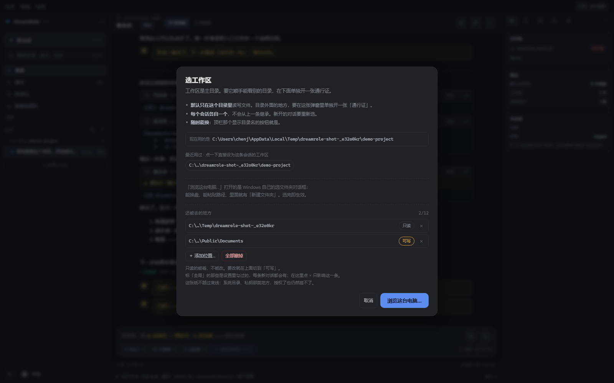

点「浏览这台电脑…」之后是这个 —— 左边「此电脑」能换盘，工具栏上就是「新建文件夹」，
右上角有搜索：

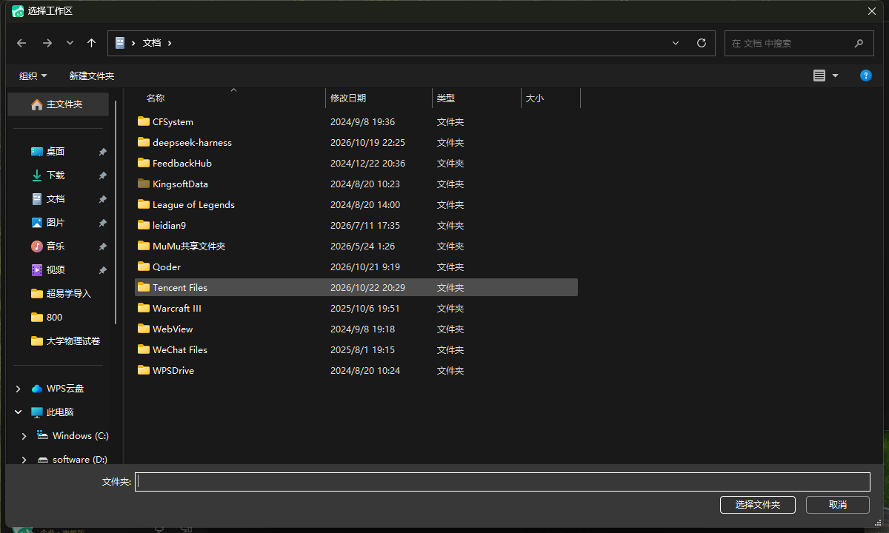

实现上没引任何第三方库 —— 用 `ctypes` 直接摸 `IFileOpenDialog`（`app/folderdialog.py`）。
不用 `tkinter.filedialog`（会额外拉一个 Tcl/Tk 运行时，打包体积翻几 MB，
而且弹出来的窗口风格跟系统不是一套），也不用 `pywin32`（一样是体积）。

前端是一次普通的 `await`：`POST /api/fs/pick-folder` 会**一直挂着**直到你选完或取消，
返回 `{"path": "D:\\work\\demo"}` 或 `{"path": null}`（取消）。它不是轮询，
所以不用猜「用户到底点没点确定」。这个端点跑在线程池里，挂着的时候不挡其它请求。

> **COM 虚表下标是个坑。** `IShellItem::GetDisplayName` 是**第 5 个**方法，写成 4 就调到了
> `GetParent` —— 参数个数不对，`SIGDN_FILESYSPATH`（`0x80058000`）被当成输出指针写进去，
> 结果是 `access violation writing 0x0000000080058000`，而且崩在服务线程里，
> 前端只看到一句「打不开系统的选文件夹对话框」。踩过一次，注释里标着了。
>
> 另外对话框必须在 **STA 线程**里跑（`CoInitializeEx(None, COINIT_APARTMENTTHREADED)`），
> 而且得给它一个 owner 窗口（没指定就取 `GetForegroundWindow()`），
> 否则对话框会**开在主窗口后面** —— 用户以为没反应，其实已经弹出来了。

### 删掉一个工作区：三道护栏，一道都不省

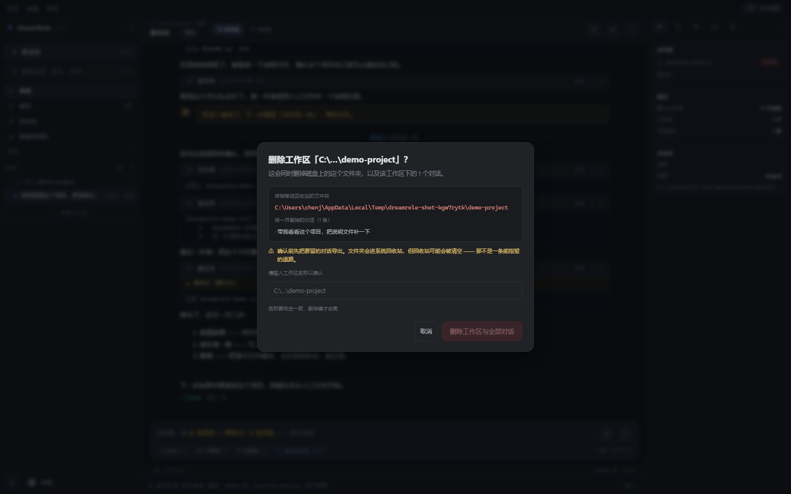

工作区那一行的 `⋯` 里最下面一项是**删除工作区…**（红的）。它删的不只是左栏那一组，
还包括磁盘上那个目录 —— 所以它必须难按：

1. **弹窗里写真实绝对路径**，外加「将一并删除的对话」清单。让人看清删的是什么，
   而不是只看到一个名字。
2. **必须手打一遍工作区名**才点亮删除键。手滑点不到。
3. **目录走系统回收站**，不是 `rm -rf`。`app/trash.py` 用 `SHFileOperationW`；
   回收站用不了的时候它**如实失败**，绝不退回去直接删。

服务端还多一层硬拦（`POST /api/workspace/trash`）：空路径、不是目录、盘符根、
用户主目录、数据目录、资源目录，以及这些目录的**祖先**，一律 403。
前端护栏挡手滑，后端拦的是「有人绕过前端」。

执行顺序是**先删会话、再移目录**。反过来的话，目录一旦移走，那些会话就变成一堆
指向不存在路径的孤儿行，而它们本来可以一起消失。

### 工作区之外：按目录发「通行证」

工作区是主目录，不是「唯一能碰的地方」。真实干活经常得顺手看一眼别处 ——
参考另一个项目里的实现、读一份放在 `D://资料` 里的源数据、把结果写进共享目录。
以前这些一律被拒，用户只能把工作区改成那个父目录，于是「工作区」这个词就没意义了。

现在选工作区的弹窗里多一块 **「还能去的地方」**：

- **默认只读。** 绝大多数需求是「去看一眼」，读不破坏任何东西；要写，就在那一行点一下切到「可写」。
- **跟着会话走**，不跟程序走；但**新会话会带上设置里那几张全局的**（见下）。
- **最多 12 张。** 不是怕性能，是怕「授权了二十个目录」之后用户自己都说不清这个 agent
  到底能去哪 —— 那种状态下边界等于不存在。
- 目录被删、盘没插时，这一条**留在列表里**并标「目录不在了」。静默丢掉用户点过的授权，
  比留着更让人糊涂。


判定规则只有一条：**最长前缀优先**。

```
授权 D://work         可写
授权 D://work//secret  只读
→ D://work//a.txt 能改，D://work//secret//b.txt 只能看
```

工作区自己也当成一张隐式的可写通行证参与比较，所以没有「工作区是例外」这种分支 ——
分支一多，规则就没法用一句话说完了。

#### 全局默认：可以有，但不能静默

这里原来写的是「不做成全局设置」，理由很硬：全局授权等于把「静默默认」又装回来了 ——
你给 A 会话开了 `D://资料`，B 会话也悄悄带着，而界面上看不出来。那和以前 `settings.json`
里那个默认的 `data/projects` 是**同一个毛病**：报错你能看见，静默默认你看不见。

但这条理由只否掉了「静默」，没否掉「全局」。用户一个一个目录地给每条新对话补通行证，
补到第十次就开始骂人 —— 那不是安全，那是折磨。

所以现在是**两层**：

| 层 | 在哪改 | 管什么 |
|---|---|---|
| 全局默认 | 设置 →「默认权限 · 新对话起手就带着」 | **新**会话建起来时抄一份 |
| 会话自己那份 | 那条对话的「选工作区」弹窗 | 这一条对话能去哪 |

四件事保证它没回到老毛病上：

1. **抄的动作只发生在建会话那一刻。** 抄完就归那条会话自己，之后各走各的。
2. **改全局不会回头动已经在的会话。** 从磁盘恢复老会话时 `inherit=False` ——
   不然「在这条对话里撤掉某个全局目录」永远撤不掉，重开一次又回来了。
3. **抄的是用户自己点过的目录**，不是程序编的（`data/projects` 那种）。
4. **界面上写着来路。** 会话里那几张全局带来的会标一个小字「全局」，
   点 × 只影响这一条 —— 不标的话，用户删了它、下条新对话又冒出来，只会认为是 bug。

授权仍然记在每个会话的 meta 里（`grants` 字段），换会话就是换一份。

#### 它不越过安全底线

`rules.py` 里那几条是**硬拒绝**，在权限档位之前就拦：写 `C://Windows`、写 `Program Files`、
读 `~/.ssh` 和云凭据。把 `C://Windows` 加进授权目录，照样写不进去。

所以界面上不用堆警告文字 —— 说清楚「能去哪」就够了，底线那层不归用户管。

#### 两个实现上的坑

**一、`ctx.resolve()` 的 `need` 默认是 `read`。**

写操作必须显式写 `ctx.resolve(path, need="write")`。默认 read 是故意的：漏标一处的后果是
「本该拒绝的写被放行」，比反过来危险得多。但这个默认值意味着**看代码看不出漏没漏** ——
所以 `selftest.py` 里有一张写工具的清单（`write_file` / `edit_file` / `make_dir` /
`copy_file` / `move_file` / `delete_file` / `apply_patch` / `archive` / `remove_junk` /
`download`），一个一个往只读目录里试，断言全部被拒。

这个测试当场抓到两个真问题：

- `delete_file` 把真实原因（「在只读目录里」）改写成了「不在项目目录内」。
  模型看到这句话会以为授权没生效，然后反复重试同一个动作。
- `shell.py` 里 `work.relative_to(root)` 在 cwd 落到授权目录时抛 `ValueError` ——
  那一句本来只是为了让输出里的 `[cwd]` 好看，结果把整条命令废了。

**二、`run_command` 是软边界，得说清楚。**

它的 cwd 也过同一套判定：没授权的目录不能当 cwd，只读目录里不许跑会改文件的命令。
但命令里写 `cd /d D://x` 是**拦不住**的。要物理隔离只能靠沙箱账户或容器，这里没做。
所以这一条的作用是「让默认落点可预期 + 降低误伤」，不是「关住」。

还有一条边界：`search_replace` 用的是 `ctx.root.glob()`，它**永远只在工作区里**，
不会跟着授权目录走。批量改文件这种事，宁愿让它够不着。

### 路径缩写：盘符不能丢

自己画列表那一版里，显示的是 `…/最后两段`。问题在于它把盘符丢了：

```
C:\Users\you\AppData\Local\Temp\a\demo   →   …/a/demo
D:\work\a\demo                             →   …/a/demo
```

两个完全不同的目录缩出来一模一样，用户没法判断点下去会去哪。现在是
`盘符 + … + 最后 N 段`（`pathTail()`）：`C:\…\a\demo` / `D:\…\a\demo`。
顶栏只留最后一段（那里只有 200px 宽，要认的是「哪个项目」，不是「在哪个父目录下」），
侧栏会话行也留一段 —— 留两段会被 CSS 再截一次，截完正好剩 `C:\…\dreamrole-…`，等于没说。

> 这个「最近用过」的点击曾经出过一次事：`addEventListener('click', pickProject)`
> 会把点击事件当第一个参数传进去。当时 `pickProject` 正好收一个「从哪个目录开始」的参数，
> 于是卡片上显示 `[object PointerEvent]`，再弹一句「打不开这个目录」。
> 修法两道：绑定处包一层 `() => pickProject()`，入口处再挡一次类型。
> 后来那个参数整条撤掉了（原因见下），但**绑定处那一层包装留着** ——
> 它挡的不是这一个 bug，是「回调签名以后又变长」这件事。
> 顺带一提：这个 bug 是 `click_check.py` 用真鼠标点出来的，合成事件和截图都看不见。

> 「从哪个目录开始」这个参数为什么撤掉：本机的 Shell API
> （`SHCreateItemFromParsingName` / `SHParseDisplayName` / `ILCreateFromPathW`）
> 无论传什么路径都返回 `E_INVALIDARG`，连 `C:\Windows` 也不行 ——
> 判断是这台机器的沙箱环境问题。**验证不了的东西不放进发布版**，
> 所以整条撤了，`API.pickFolder()` 只收一个标题。
> 对话框默认从「上次访问的位置」打开，实际用起来差别不大。

---

## 四种模式

模式不是一个标签，它同时改两样东西：**给模型的提示词**和**允许用的工具**。

| 模式 | 干什么 | 工具 | 权限 |
|---|---|---|---|
| **执行** | 把事做完 | 全部 | 跟你的设置 |
| **规划** | 只出方案，不动手 | 只读 + 阶段 | 强制只读 |
| **问答** | 解释，不写代码 | 只读 | 强制只读 |
| **带练** | 一步一步教 | 全部 | 强制分阶段 |

带练模式是最特别的一个。它的提示词里写死了这些规矩：

- 拆 4~8 个阶段，**一个阶段最多 3 个动作**；
- 单次输出不超过 30 行；
- 每个动作都要解释「为什么现在做这个」；
- 阶段末必须提问并**停下来等你**；
- 报错时先让你猜原因，别直接给答案；
- 收尾时教一个以后用得上的习惯。

提示词管不住的部分，代码里补了两道：

1. **没开阶段就不许干活。** 动手之前必须先 `set_stage`，否则那次工具调用直接失败
   （只拦前两次，防卡死）。
2. **一个阶段就收尾会被打回。** 实测 DeepSeek 会把「分两步」理解成「一个阶段里做两件事」，
   然后一口气总结完 —— 那等于没带。所以它想收尾时，如果这一轮只开了一个阶段，
   就把总结打回一次，让它开下一个阶段（最多两次）。

阶段交接处会停下来问「继续，我看着」还是「停一下，我来接手」。
这两件事都写在代码里而不只是提示词里，因为**能靠提示词办成的事，模型会有一半概率不办**。

---

## 专家：换一种立场看问题

专家**不是技能**。这两件事最容易做混：

|  | 换的是 | 怎么生效 | 回答的问题 |
|---|---|---|---|
| 技能 | **能力** | 按需加载说明书，不占常驻上下文 | 「你会不会做 PPT」 |
| 专家 | **立场** | 常驻改写系统提示的身份 | 「你用什么方法看这件事」 |

所以一个专家可以配几个技能，但技能本身不改变你是谁。

内置五个：**执行者**（少说多做）、**代码审阅**（只挑问题，不重写）、
**带练导师**（每步都让你自己动手）、**数据分析**（先问口径再算数）、
**技术写作**（先搭骨架再填肉）。也可以自己写一个：填名字、一句话、方法论。

绑定后：

- 方法论拼在**模式提示之后、技能之前** —— 先定「你是谁」，再告诉它「你会什么」；
- 如果专家声明了工具白名单，再跟模式的工具集**取交集**（模式说能用，专家说只用这些）；
- 专家可以带一个默认模式（比如审阅专家默认「问答」）。绑定时套用，但**不会硬抢**
  你已经手动切过的模式。

顶栏会出现一个带图标的小标，显示当前是谁在看这件事。没有这个小标，
「我明明换了专家它怎么还这么说话」就会变成一个玄学问题。

配置落在 `data/experts.json`。它是**结构化配置**（还带工具白名单、默认模式），
不是一篇文档 —— 用户改的是字段，不是正文。

---

## 深度思考：四档，以及每家的参数怎么翻译

输入框右上角有一个「不想」按钮，点开是四档：**不想 / 浅想 / 想一想 / 深想**。
档位跟着会话走 —— 一条做重构的会话可以一直是「深想」，另一条问闲事的保持「不想」。

关键在于：**「思考」不是一个统一参数。**

| 哪一家 | 怎么开 | 用什么 |
|---|---|---|
| OpenAI | `reasoning_effort` | `low` / `medium` / `high` |
| 通义（DashScope 兼容模式） | `extra_body.enable_thinking` + `thinking_budget` | 1024 / 4096 / 16000 |
| 智谱 | `extra_body.thinking.type` | `enabled` |
| DeepSeek | **换模型** | `deepseek-reasoner` |
| OpenRouter | `extra_body.reasoning.effort` | `low` / `medium` / `high` |
| Ollama / 其它 | 没有 | 老实说「这一家没提供可调的深度」 |

如果每处 `if/elif`，加一家就要回来改一次。所以 `app/thinking.py` 是一张**翻译表**：

```python
apply_level(provider, model, level, has_tools) -> (实际模型, 额外参数, 说明)
```

调用方只需要这一个函数，不用知道谁用哪个字段。

两件事是刻意的：

- **默认 off。** 思考会显著变贵变慢。第一次用应该拿到快的那个版本，想要更深的推理时自己调 ——
  而不是每次都等它想十秒。
- **调不通不报错。** 兼容端点常常「收下参数然后不理」，或者干脆 400。退回去的代价只是「这次没思考」，
  把这件事写进说明让界面说出来，比抛一个用户看不懂的异常好。DeepSeek 那条还有额外的坑：
  `deepseek-reasoner` 不支持 function calling，所以**这一轮要用工具时不换模型**，退回普通模型并说清原因。

思维链单独成一种事件（`reasoning`），不混进回答里 —— 它和「我要对你说的话」是两回事。
界面上是一条可折叠的灰条，导出 md / html 时进 `<details>`。

---

## 安全：三层分工，顺序不能反

| 层 | 是什么 | 能不能放松 |
|---|---|---|
| `rules.py` | **底线** —— 5 条内置（系统目录不许写、私钥目录不许读、`rm -rf /` 一类、`curl \| sh`、云元数据地址） | 不能。任何权限档位都不许 |
| `permissions.py` | **偏好** —— 四档权限的判定表 | 能。你可以点「全权」 |
| `audit.py` | **留证** —— JSONL 落盘，带哈希链 | 不能改，只能追加 |

**顺序不能反**：档位是用户可以放松的偏好，「往系统目录写」「读出私钥」这种底线不该因为他点了「全权」
就变成允许。所以 `_run_tool` 里是先过 `rules.check`，再问 `permissions.decide`。

内置规则长这样（`app/rules.py` 顶部，纯数据）：

```python
{"id": "no-system-write", "kind": "path", "action": "deny",
 "patterns": ["C:/Windows/**", "C:/Program Files/**", "/etc/**"], "why": "…"}
```

你可以从界面上加自己的，**加进去就是底线** —— 只有你能删掉它。

审计链：`hash = sha256(上一条的 hash + 这一条的正文)`。任何一条被改过、被删过、被中间插入过，
`verify()` 都能指出第几条开始对不上。清空也会留一条 —— 否则「链突然变短」这件事永远解释不清。

出站打码（`dlp.py`）在**发给模型之前**动手：私钥块、`sk-` / `sk-ant-`、AWS、GitHub、Slack、
`AIza`、JWT、`Bearer`、`password=xxx`，10 条正则，换成 `***`。命中时界面上会有一句提示，
不会静默 —— 静默打码会让模型在读到 `***` 时给出莫名其妙的答案，而你不知道为什么。

---

## 助理：一个有人设、有自己的屋子的人

**助理和专家别混：**

- 专家是「**换一种看法**」—— 你还是你，只是这次让它按律师的思路读一遍；
- 助理是「**另一个存在**」—— 它有自己的名字、自己的说话方式、自己的项目目录、自己的对话记录。
  你切回它，接的是它那间屋子里上次没收尾的事。

所以助理必须有目录，这不是整理癖，是功能本身：

```
data/assistants/<id>/
  assistant.json     人设与设置
  workspace/         它干活的地方（产物都写在这里）
  memory/            它自己的长期记忆
  exports/           它导出的东西
data/traces/<id>/    它的对话记录（按助理分目录，见 store.scope_of）
```

会话层只认一条：**有 `assistant` 的会话，工作区就是那间屋子**。不用你选，
也不能改 —— 助理的「固定住所」就是它的定义。普通会话仍然每次都要选目录，这两件事不能混成一条规则。

删助理只删这个**角色**，工作区和对话记录都留在原地。干了三个月活的东西，不该被一次误点带走。

### 群聊：规则是一等公民

几个助理对同一件事各说各话，如果不规定谁先说、说完算不算数，它就会变成一场没人收尾的讨论。
所以群聊必须有一个**发言规则**，它是数据，不是提示词里写一句「请有序发言」：

| 规则 | 行为 |
|---|---|
| `round_robin` | 轮流，每人一轮 |
| `mention` | 只让被点到名的说。谁都没点名时**明确告诉你「点个名」**，不自作主张 |
| `host` | 主持人先开场，其他人依次，主持人收尾 |

群里有两点刻意的设计：

- **群成员不给工具。** 一轮讨论里四个人各调三次工具，谁写了哪个文件、写坏了算谁的，你根本追不回来。
  群聊的产出是「看法」；真要动手，每位助理旁边都有「单独聊」—— 那才是能干活的入口。
- **每个人说的话都标了是谁说的。** 不标的话，屏幕上就是一串没有主语的观点，你接不上「刚才那句是谁在反对谁」。

群聊也有自己的落脚目录（`data/assistants/groups/<id>/workspace`）。讨论不写文件，但目录仍然存在 ——
「没有工作区就不许跑」是一条不变量，群聊不该是一条例外。例外一多，这条不变量就形同虚设。

#### 加人、移人、删角色：三个动作，都不该躲起来

团队页左栏「成员」那几行后面有一枚淡淡的 `×`，指上去变红，点了是**移出这个群**；
频道头上还有一个「成员」按钮，点开是成员表 —— 在群里的每行有「移出群」，
还没进来的每行是「＋ 拉进来」，两边都还有一枚「删角色」。

「移出群」和「删角色」刻意做成**两个按钮**，不共用一个 `×`：
前者只是不在这个群里说话（屋子、它自己的对话都还在，随时能拉回来），
后者是这个人真的没了（屋子里的文件仍然留着）。一个 `×` 承担两种语义，
误点的代价是删掉一个角色 —— 这种设计以前吃过亏，不再做。

群至少要两个人。只剩一个时「移出」会被拒并说明「那就不再是群，是私聊」——
解散群是另一个动作，不该被伪装成「移出一个」。

> 这里原来有一张旧的「助理卡片列表」，改版之后没人调用了。
> 结果「删角色」和「打开屋子」两个动作被困在一条走不到的路径上 ——
> 用户报的「智能团成员没有删除功能」就是这么来的。那段代码已经整段删掉，
> 两个动作搬进团队页（删在频道头和成员表里，打开屋子在右栏「会话概况」里，
> 那行路径点一下就开资源管理器）。

三个边界，写在这里免得以后又忘：

- **正在跑的那一轮不拦。** 成员表和系统提示是同一时刻读的，跑到一半换人，
  会出现「这一轮按三个人算、下一句按两个人算」。所以移人只影响下一轮。
- **移出不等于删角色**，见上。
- **删角色不删文件。** 确认框里会把留下的位置写出来，让你知道东西在哪。

#### 他们为什么不互相说话（病根在角色，不在提示词）

用户的投诉原话是「他们之间并不会互相沟通，都是各自说各自的」。把它当成提示词问题去调，
怎么调都不会好 —— 因为落盘和回灌的格式就是错的：

```
存储：  assistant  "【秘书】deadline 太紧，砍掉第二项。"
        assistant  "【研究】我不同意砍第二项。"
回灌：  原样把这两条以 assistant 身份发回去
```

模型看到的是一份「**它自己**刚刚说过这些」的对话。于是每一位成员都在回答用户，
没有一个人在回应前一位。名字写在正文里也没用 —— 那是内容，不是结构。

改法只有一条：**回灌时按「我」重新分配角色**（`app/group.py` 的 `transcript`）。

| 存储里 | 发给「我」时 |
|---|---|
| `assistant` + 名字是「我」 | `assistant`，去掉开头的【名字】 |
| `assistant` + 名字不是「我」 | **`user`**，前缀【名字】 |
| `user` | `user`，前缀【用户】 |

不能靠给消息加 `speaker` 字段：OpenAI 兼容接口只认 `role` / `content`
（`assistant` 可以带 `tool_calls`），多塞一个字段，服务端要么忽略、要么报错。
所以这件事只能在**拼请求的那一步**做，不能存在盘上。

配套改了四处，缺一条就还是各说各话：

- **`[skip]`**：没补充就回 `[skip]`，不发正文。不给人「弃权」这个动作，
  它就只能硬说一句，而硬说的那句一定和别人重合。
- **走几轮**：一轮 `round_robin` 是「每人说一句就散会」。表单里能选 2～3 轮，
  第二轮才真的会有人接前一句。上限 3（`group.MAX_ROUNDS`）—— 再多是在烧钱。
- **每人分工**：`roles[assistant_id]`，进群提示。不写分工，四个通用人设被问到同一个问题，
  答案必然长得一样 —— 那看起来也像「没在听」。
- **盖掉单干的话术**：群成员的系统提示里原来带着整套编程 agent 的说明
  （分阶段推进、写完必须验证、用工具……），而群成员**没有工具**。
  一段 `_OVERRIDE` 块把那些按下去，否则它会在开会时反复说「我这就去改」。

还有一条**没有**改：并发。有人分析说「几个人同时被调用，互相看不见」——
我们本来就串行（`_group_loop` 是一个 for 循环），这条不适用。

#### 发完消息不该把人弹走

原来的实现是：团队页的输入框 → 建一条会话 → `Sidebar.show('sessions')` → 整页跳到会话页。
理由是「跑的机制都在对话页」。那些机制确实在对话页，但用户要的是**接着说话**，
不是「看别人做事」。跳走的代价不是一次点击，是刚看着的那一屋子人突然不见了。

现在留在这间屋子里：

- 事件流还是同一条。`handleStream` 处理完**之后**把同一条消息递给团队页
  （`Panels.teamFeed`）—— 必须是之后，因为团队页的状态条读的就是 `state.running` / `state.beat`，
  递在前面它永远看到上一条消息的状态。
- 输入框上方多一条状态条：`正在跑 7s · 戊` + 「看过程 →」+「停下」；
  有工具要审批时换成 `有一步在等你说可以` + 「去点头 →」。闲着时整条 `display:none`。
- 「看过程 →」不是跳转，是把对话页叫到前面来 —— 那条会话一直在被同一条流更新，过去就是「已经在跑」的样子。
- 这一轮还在跑时不让再发。不是怕并发（每次发消息本来就另开一条会话），
  是因为界面只有一条流：再发一句，流切到新会话，上一轮的回答就再也贴不进这间屋子了。

顺带修了一个更难发现的：**一个频道 = 一条房间，不是一条会话**。
每次发消息都会新开一条会话，而团队页原来只画「最新那条」——
用户发第二句时第一句就从墙上消失了，看上去像它把刚才的话忘了。
现在把最近 6 条会话拼成一条时间线（封顶 40 条消息）。

---

## 三条通道：同一套内核，从哪几个门进来

| 通道 | 怎么用 |
|---|---|
| 桌面窗口 | 默认。点开会话、看图、审批权限都在这里 |
| 命令行 | `DreamRole.exe chat --project D:/x "看一下这个项目"`，不开窗口也能跑一轮 |
| 本地接口 | 给别的程序用。默认关着，需要时在「运行」栏里打开 |

一条会话被窗口建、被命令行接着说了两句、再被外部脚本收了尾 —— 这是正常用法。
所以**每个请求打进来先认门，再干活**，账才对得上（「运行」栏里那三个数字就是这本账）。

命令行刻意走 HTTP 而不是直接调 `Session`。走捷径的话，命令行看到的行为就会和界面悄悄不一样，
而那种差异最费时间。

权限闸门在命令行里也要问。**「没人可以问」不等于「可以替用户同意」**——
所以非交互模式下遇到闸门默认**跳过**，并把这一步明确说出来（`--yes` 才自动同意）。

外部来源的规矩只有一条，但很硬：**不是本机来的请求必须带 `X-DreamRole-Token`**。
本机回环地址不验 —— 每次开窗口都要输 token 的产品，用户第一件事是去关掉校验，等于没有。

---

## 运行时探测：不写死 `python`

工具里写死 `python` 的后果是：用户机器上那个是 Microsoft Store 的 0 字节转发器，一调就弹商店；
写死 `node` 则可能在 nvm 切过版本之后指向旧目录。

所以启动后探一次（`python` `node` `git` `rg` `ffmpeg` `pwsh` `sqlite3` `curl`），
探到了记住，探不到就老实说「这条命令现在不能跑」。三条纪律：

1. **探测不执行任何有副作用的命令** —— 只跑 `<exe> --version` 这类；
2. **结果带 `usable` 而不是只有 `found`** —— 找到了但版本太低、是商店转发器，和没找到是两件事；
3. **用户可以覆盖路径** —— 探测错了一定有救，不然就只能重装。

结果缓存 90 秒。「装完东西回来点一下重新探」这件事要能立刻看到，不用重启。

---

## 两套底层：role1 与 role2

建一条会话的时候，你先定「这条由谁在跑」。两个选项，两个名字，不是同一件东西的两个模式：

| | **Role 1 · DreamRole 内核** | **Role 2 · DSH 内核** |
|---|---|---|
| 谁在跑 | 这个项目自己那套循环（`app/session.py`） | 本机装的 DeepSeek Harness（`D:\DeepSeek Harness`） |
| 工具 | DreamRole 自己的 56 个 | DSH 自带的那套，DreamRole 的工具**不参与** |
| 审批 | 四档权限 + 弹卡的审批 | **没有**。headless 模式没有审批通道，它要做什么就直接做 |
| 技能 | DreamRole 的技能目录 | DSH 自己的技能，这一轮挂的技能不生效 |
| 记忆 | 三层记忆注入提示词 | 不注入（DSH 有自己的会话历史） |
| 上下文压缩 | 自己算，六档窗口 + 三档阈值 | 交给 DSH |

界面上的规矩只有一条：**建好就绑死，中途不给换。** 顶栏那枚胶囊在建会话之前说「下一条用哪个」，
建完之后显示的就是这一条的绑定值，点开只能看说明，选不了。

为什么不给换：两套内核对「历史」的理解根本不同 —— role1 的上下文是自己拼的 `messages` 数组，
role2 的上下文在 DSH 的 sessionId 里。中途硬换，等于把一份它从没见过的记录塞给模型，
读起来就是天书，而且**看起来一切正常**（它会顺着编）。快的做法是「随便换」，代价是一堆
看不出错在哪的会话。

### role2 是怎么接上的

不走 `dsh.cmd`（它内部用 cmd 拼引号，路径里一有空格就炸成 `'D:\DeepSeek' 不是内部或外部命令`），
直接起 exe：

```
DeepSeek Harness.exe --expose-internals <cli.js> --profile headless --json "任务"
  env: ELECTRON_RUN_AS_NODE=1, DEEPSEEK_API_KEY=<从设置里借>
```

stdout 是一串 NDJSON，一行一个事件。实测这几种（`app/dsh_engine.py` 逐个翻译）：

| DSH 事件 | 里面有什么 | 翻译成 |
|---|---|---|
| `session` | `sessionId` / `cwd` | 存下 sessionId，多轮靠它续 |
| `status` | `phase: turn_start / step_start / step_end / turn_end`，带 `usage` | `step_end` 加 token；`turn_end.reason.kind=error` 记错误 |
| `thinking` | 整段推理 | `reasoning` 事件 |
| `text` | **整段**正文（不是增量） | 切成小段推 `delta`，再落一条 `answer` |
| `tool_call` | `callId` / `tool` / `input` | `action`，参数压成 `path=a.txt, n=2` 这种摘要 |
| `tool_result` | `callId` / `status` / `result` | `result`，`parent_id` 指回上面那张卡 |
| `final` | 兜底全文 | 前面没答过就用它 |

冒烟脚本 `python scripts/role2_check.py`（加 `--offline` 只验定位，不花 token）会真跑一轮，
断言 18 项：定位、登记、事件四类、`parent_id` 链、答复里真有文件内容、usage、没有 error notice。

### 一个坑：`app.asar` 是文件，不是目录

DSH 的 `cli.js` 在 `resources/app.asar` 里面。asar 在操作系统眼里是**一个 182MB 的文件**，
`Path("app.asar/dsh/.../cli.js").exists()` 永远是 `False` —— 而把它原样喂给 Electron 是对的路由。

所以定位逻辑不能问文件系统「这个路径在不在」，得自己读 asar 的 JSON 头（前 16 字节里
`[12:16]` 是小端序的 json 长度），在里面找 `dsh-desktop-host`。读不出来返回 `None` ——
「不知道」不能当成「不存在」，否则一个格式变了的新版本会被判成「没装」。

`locate()` 带 15 秒缓存，因为 `snapshot()` 每推一次状态都会取一次标签，而读一次 asar 头是几十毫秒；
改了 `dsh_path` 会 `forget()` 丢掉缓存。

---

## 三层记忆

| 层 | 存在哪 | 什么时候用 |
|---|---|---|
| **项目记忆** | 按工作目录哈希一个文件 | 只对这个目录成立的约定：「这个仓库用 pnpm」 |
| **用户偏好** | 一个文件，不分项目 | 换项目也该遵守：「回答别用 emoji」 |
| **每日记录** | 一天一个文件 | 流水账，写给未来的自己看 |

为什么必须分开：项目记忆要是混在一起，「这个仓库用 pnpm」跑到另一个仓库就是错的；
每日记录天生越写越长，混进长期记忆会把真正重要的约定挤出提示词窗口。

**注入提示词的只有项目记忆（最近 12 条）和用户偏好。** 每日记录不进 ——
该跨会话生效的结论，由下面的自动记忆沉淀到项目记忆里。

你也可以在左栏「记忆」里直接改：选一层 → 编辑全文 → 保存，或者「加一条」追加带时间戳的结论。
今天的记录即使还空着也永远占一格，否则「今天还没记」这件事在界面里是不存在的。

### 自动记忆：修的是「一直是空的」这件事

记忆这套东西写了很久，但 `.data/memory/` 一直是空的。原因不在写入代码，
而在**入口只有一条**：全靠模型在对话里自己想起调 `memory_write`。
而那个工具在 `permissions.DANGER_TOOLS` 里 —— 标准档下每写一条都要用户点一次确认。
于是它几乎从不被调用，用户看到的「记忆」永远是一排「还没有内容」。

现在改成**每轮结束自动记一笔**（`app/automemory.py`），开关在设置里，三档：

| 档 | 每轮做什么 | 花不花钱 |
|---|---|---|
| **关闭** | 什么都不做，回到「只有模型主动调工具才记」 | 不花 |
| **每日记录** | 从这一轮的事件流里捞事实，写一行当日流水 | 不花 |
| **每日记录 + 项目记忆**（默认） | 上面的一行 + 真动过文件时再抽 1~2 条结论进项目记忆 | 只在这一轮动过文件时，多一次很小的调用 |

三个细节，都是为了「别让这件事变成新的负担」：

- **事实从事件流里捞，不另存一套账。** 用户说了什么、这轮动了哪些文件、跑了什么命令、
  结果如何 —— 全在 `session.events` 里。捞出来写成
  `用户：…；动了：src/main.py；跑了：pytest；结果：改好了` 这么一行。
  路径折成相对工作区（`src/main.py` 而不是 `F:\repo\src\main.py`），否则同一条结论换个盘符就再也对不上。
- **纯聊天不动文件就不调模型。** 一轮下来既没有文件也没有像样的命令，直接返回 ——
  「今天天气不错」不值得花钱抽结论。`dir` / `ls` / `git status` 这类看一眼的命令也不算「做过事」。
- **重复的结论不记第二遍。** 抽出来的每条都要过 `already_known()`：把时间戳、标点、空白去掉之后
  相等**或互相包含**就算已知。否则同一条「这个仓库用 pnpm」会因为「改了两个文件」被记十遍，
  最终把提示词里真正重要的那几条挤出去。

这一整套跑在**后台线程**里，不挡下一轮。失败一律静默 —— 记忆挂了不该让对话也挂。
放在 `run_turn` 的 `try` 里而不是 `finally` 里：中断、报错、暂停的那一轮不该被当成「经验」记下来。

---

## 改动、退回、检查点，是同一件事的三层

以前这里是两栏：「改动」按文件看，「检查点」按轮看，退回按钮两边各有一份。
用下来最别扭的不是功能少，而是**关系丢了** —— 一条「某某文件已修改」的平铺记录，
既不说是谁为了什么改的，也不说改到了第几步。用户点「回滚」的时候，
脑子里得先把这三层关系重建一遍，重建错了就是退错东西。

所以现在只有一栏、一条路径：

```
对话  →  这个对话的产物（文件）  →  这个文件的阶段  →  退回到某一阶段
```

- **第一层**：哪些对话留下过改动。标题、几个文件、几次改动、最后动的时间；
- **第二层**：这条对话动过哪些文件。每个文件几个阶段、现在还在不在、有没有被外面改过；
  底下还有一折「整轮回退」，也就是原来那栏检查点 —— 它本来讲的就是「**这一轮**
  它一共动了哪些文件」，属于对话，不该单独占一个入口；
- **第三层**：这个文件的改动时间线。阶段 0 是「最初」，往后每条是一次改动或一次退回，
  当前停在哪个阶段会被点亮。每段都能看那一次的 diff，也能直接退回去。

面包屑在顶上，随时能退回上一层。整行可点 —— 缩进在 236px 的窄栏里根本看不出来，
所以「能不能往下」用行尾那个箭头说。

### 阶段是什么

`change-history.json` 里每一条都留着 `before` 和 `after`。按 `(会话, 路径)` 聚起来
就是一条时间线：第 k 个阶段 = 第 k 次改动之后的样子，第 0 个阶段 = 它第一次被碰之前的样子。

- 退到第 0 阶段时，如果那个文件本来就不存在（记录里 `existed=false`），
  就把它**移进回收站**，而不是写一个空文件 —— 空文件和「本来就没有」是两件事；
- 退回本身也会被记成一个阶段（`kind=restore`），标签是「退回到第 k 阶段」。
  不记的话，账本还停在「最新内容」，下一次漂移判定就开始说假话；
- 一个文件最多展示 40 个阶段，更早的会被滚动清理（`change-history.json` 上限 1200 条），
  裁掉的时候界面上会写明。

接口一层一条：

```
GET  /api/changes/threads                   → 第一层：对话
GET  /api/changes/thread?cid=               → 第二层：产物（含 turns，整轮回退）
GET  /api/changes/timeline?cid=&path=       → 第三层：阶段
POST /api/changes/restore {cid,path,stage}  → 退回（漂移要 force）
```

`POST /api/changes/revert` 还留着，它是「退回最近一次」的简化版，给老调用方和脚本用。

### 归属：改动的主键是 `(会话, 文件路径)`

改动记录的主键是 **`(会话, 文件路径)`**，不是路径。

这不是洁癖。同一个文件完全可能被 A 会话改过、又被 B 会话改过。只按路径记，
第二次就把第一次顶掉了 —— A 那个「回滚」按钮会变成「回滚成 B 改之前的样子」。
那不是回滚，是替 B 撤销了一次它不知道的改动。所以两条账必须并存，
退回时必须指明「是哪条对话的哪一次」。

`restore` / `revert` 不带 `cid` 直接 400。这里宁可不方便，也不能猜：
猜错的代价是覆盖掉别人正当的修改。

### 一条改动什么时候退不了

判定集中在一个函数里（`app/changes.py`），按固定顺序，只报第一个说得出口的理由：

| 顺序 | 状态 | 能做什么 |
|---|---|---|
| 1 | 记录没有归属对话（旧版本遗留） | 什么都不行 |
| 2 | 所属对话已删除 / 文件被外部删掉 | 什么都不行，**连 diff 都不给看** |
| 3 | 所属对话正在跑 | 等这一轮结束 |
| 4 | 已经退回过了 | 不能再退第二次 |
| 5 | 磁盘内容 ≠ 时间线最后一阶段 | 能退，但要勾「强制」—— 别人也改过它 |

**界面置灰是提示，接口校验才是防线**，两者用的是同一个函数。
分成两套逻辑的话，迟早会出现「按钮是灰的但接口肯做」或者反过来。

第 5 种最微妙：你要退到「第 k 阶段」，但磁盘上连最后一阶段都不是了。
不提醒就退，等于悄悄抹掉别人的工作。所以确认框会把这句话写出来，按钮也改成「强制退回」。

### 删除一条对话时，级联会发生什么

删除是不可逆动作，所以顺序是：**先算代价 → 再动文件 → 最后清账本**。

1. `GET /api/traces/{cid}/impact` 先把代价算出来：几条改动、几个轮次、涉及哪些文件；
   删除确认框就拿这些数字说话。没有代价就明说「不影响磁盘上的任何东西」；
2. 轨迹和侧车文件进回收站（不是彻底删）；
3. **确认文件真的不在了**，才清账本 —— 文件没搬走时直接 409 返回，一行账都不动。
   反过来（先清账本）中途失败会留下「会话还在、改动没了」，那是最糟的不一致；
4. 改动记录和轮次历史**一起删掉**（`store.forget_cid`）。

**为什么是真删，不搬去别处藏着**：早先有个「墓园」设计，把删掉的会话的记录挪进
`change-graveyard.json`。用下来发现它是错的 —— 用户点「删除对话」时想的就是
「这些都别留了」，结果账本里还压着一份谁也看不见的副本，实际效果只有一个：占地方。
代价是「那条会话到底改过什么」再也查不到了，这个代价由删除确认框来承担：
点删除之前先把「要清掉 N 条改动、M 个轮次」说清楚。

### 对话不存在，但记录还在

这是真实会发生的状态：用户手删了 `data/traces/` 里的某个文件，或者把别人的 `data` 拷了过来。
这时记录还在账上，但它的归属没了。处理方式是**标成失效而不是隐藏**：

- 改动栏第一层单独一折「对话已删除（N 条）」，压暗、写明「所属对话已删除」；
- 点得进去看，但每一层的退回按钮都是禁用态，接口那边同样拒绝；
- 折里有一个「全清掉」，走 `POST /api/changes/purge`，把这些孤儿记录真删掉 ——
  失效记录留在界面上是灰的、点不动的，属于纯噪音，得给人一个清掉的口子。

灰色已经说明「不能点」，所以旁边还必须有一行字说明「为什么」——
只给灰度不给原因，用户只会觉得坏了。

### 会话列表的四个动作

以前一行只有一个 `✕`。删除、置顶、归档、改名全要塞进 236px 的一行里，
每个都只剩一个图标，点错一次就少一条会话。现在收进一个 `⋯`（悬停出现，右键也行）：

| 动作 | 行为 |
|---|---|
| 置顶 | 排到列表最前，标记跨会话保留 |
| 重命名 | 只改列表里怎么显示，不动内容；标题不能被改成空 |
| 归档 | 从默认列表收起，「已归档」里还能看到、还能打开 |
| 删除 | 先弹影响面，再说代价 |

**归档 ≠ 失效**：归档的会话照样能打开、改动照样能退。把它算成失效，
用户会以为归档等于删除，从此不敢点。视觉上也只压暗标题，不做成灰块。

**「显示已归档」曾经点下去什么都不发生**，不是开关坏了，是数据根本没到前端：
`GET /api/traces` 的默认值是 `archived=0`（只回未归档的），而前端那次没带参数，
拿回来的列表里本来就没有归档会话，过滤写得再对也变不出来。现在列表一次拿全
（`archived=1`）、开关只决定画不画 —— 多读几条本地 JSON 不值钱，换回来的是
空态能如实说「全部 3 条会话都归档了」而不是「还没有会话」。同理，`?archived=1`
可以直接深链到「连归档一起看」的列表，截图和排查都省一步。

顺手修了窄侧栏下的两个毛病：`已归档 / 置顶` 这两个标签原来排在行尾，
而这一行是 flex 不换行 —— 尾巴先被切，最该看见的标记正好没了；现在标签排最前，
让最长的路径去挨那一刀。meta 整行也加了 `nowrap`，否则「2 天前」会被拆成
「2 天／前」两行，比溢出还难看。

---


## 产物：这个对话到底做出了什么

右上角那个方块图标（`Alt+A`）。按一下，列出一条会话往磁盘上写过的所有东西：

- **新建** —— 这条对话之前没有、现在有的文件；
- **修改** —— 原来就有、被改过的；
- **截图** —— `screenshot` 存到工作区 `shots/` 下的图。

每条带文件名、相对工作区的路径、发生在第几轮、写了多少次、还在不在盘上。
能做的动作只有四个：看 diff、预览（图片）、在文件夹里定位、复制路径。

**为什么不另建一本「产物账」**：轨迹本来就是这产品的阅读对象（打开一条会话看它怎么长出来的），
再造一份清单，迟早会和轨迹对不上 —— 而两边对不上是最难查的那类问题。
所以产物是从两个已有的地方读出来的：**轨迹里的工具调用**给结构和轮次，
**改动历史**给「这个文件之前存不存在」和 diff 需要的快照。按绝对路径对齐。

**为什么产物另有一个 diff 接口**：产物的语义是「这条会话第一次动它之前 → 它最后一次之后」，
而 `/api/changes/diff` 看的是**一条改动**（一次 `write_file` 的前后）。
一个是区间，一个是点，混用会把「改了三版」说成「改了一版」。
两边现在都按对话分账，不会再串号 —— 但口径不同，仍然是两个接口。

**为什么 `run_command` 生成的文件不算**：它的参数里没有「写到哪」。硬猜一个
「最近改动过的文件」会给出一个看着完整其实漏了的清单 —— 那比明确不列更糟。
面板底部也把这句话写在明面上。

`POST /api/reveal` 只做「在文件管理器里定位」这一件事：不执行、不打开文件本身，路径必须先存在。
`/api/artifact/raw` 只放图片（png/jpg/webp/gif/bmp），因为它存在的唯一理由是「截图得能看」。

---

## 个性化

设置里有一段「个性化要求」，每一轮都注入系统提示，**位置在最后**——优先级高于模式和基础规矩。
通用规矩是「一般不这样」，你写的是「我就要这样」。

写「怎么说话、怎么做事」比写「你是一个资深专家」有用：

```
用简体中文；先给结论再给理由；不要写「好的，我来帮你」这种开场白。
```

---

## 四档权限

权限决定「什么时候停下来问你」。它是一张**判定表**，不是四套代码：

| 档位 | 只读工具 | 会改文件 | 危险动作 |
|---|---|---|---|
| 只读 | 放行 | 拒绝 | 拒绝 |
| 标准 | 放行 | **问** | **问** |
| 分阶段 | 放行 | 放行 | **问** |
| 全权 | 放行 | 放行 | 放行 |

工具按类别登记（`read` / `write` / `danger`），加新工具只需要标一下类别，不用回来改权限逻辑。

点过「以后都允许」的工具会存进 `settings.json` 的 `approvals`，本机永久记住。

**断点超时一律按「停下」处理。** 不会替你往下走 —— 你走个神回来发现它干完了你没同意的事，是不可接受的。

> **权限和「范围」是两根轴，别指望用一根解决另一根。**
> 权限管的是「要不要问你」，范围管的是「能去哪」。把权限调到「全权」，
> agent 只是在自己的圈子里更自由，一步也走不出去；反过来，授权一个只读目录，
> 也不会让写操作变成不用问你。
> 所以想让它能看到别处，正确的动作是**加一张通行证**（见「工作区」那节），
> 而不是把它提到「全权」。

---

## 工具矩阵（56 个）

| 类别 | 工具 |
|---|---|
| 文件 | `list_dir` `read_file` `write_file` `edit_file` `apply_patch` `copy_file` `move_file` `make_dir` `delete_file` `grep` `glob` `archive` `image_info` `read_many` `file_stat` `tail_file` `diff_text` `search_replace` `find_duplicates` |
| 执行 | `run_command` `list_processes` `which_command` |
| 数据 | `sqlite_query` `calculate` `csv_query` `json_query` `text_stats` |
| 联网 | `web_search` `web_fetch` `http_request` `download` |
| 系统 | `system_info` `port_check` `env_var` |
| 时间 | `now` `date_math` |
| 清理 | `scan_junk` `remove_junk` |
| 电脑 | `open_target` `list_windows` `focus_window` `screenshot` `type_text` `press_keys` `mouse_click` `clipboard` |
| 软件 | `list_software` `open_software` |
| 记忆 | `memory_read` `memory_write` |
| 会话层 | `set_stage` `skill_load` `skill_create` `subagent` `schedule_create` `todo_write` |

七个「电脑」类工具默认是关的 —— 它们等于把键盘鼠标交出去，得你自己在设置里点开。
「软件」那两个是开着的：`list_software` 只读，`open_software` 只认清单里那 100 多个名字
（`open_target` 能打开任意路径和网址，管得更宽，所以它才默认关着）。
界面上按「文件 / 执行 / 数据 / 联网 / 系统 / 时间 / 桌面 / 软件 / 记忆 / 清理 / 协作」分组折叠，
不是一个 56 行的长列表。分组表里没有的组不会被丢掉，会顺到末尾折叠显示 —— 加组不用改前端。

第二批加进来的这几个，都是**真拿去改项目时最先撞墙的地方**：

- `apply_patch`：一次改多处。比连调五次 `edit_file` 安全 —— **任何一处 `find` 匹配不上，整份文件一个字节都不动**。
  连调五次的话，改到第三处失败时前两处已经落盘，模型通常不会主动回滚，你看到的是一份「改了一半」的文件。
- `copy_file` / `move_file` / `make_dir`：这些以前只能靠 `run_command` 敲 shell，跨平台就翻车。
- `http_request`：和 `web_fetch` 分工明确。那个是「读网页」，这个是「调接口」—— 4xx/5xx 的正文也要拿回来，
  不然模型不知道怎么改参数。它算**写类**工具：不动本地文件，但会把数据发出去。
- `sqlite_query`：用 `mode=ro` 打开，不是「检查 SQL 里有没有写关键字」。字符串匹配能被注释、大小写、
  `PRAGMA` 绕过几十种，只读连接才是真的只读。
- `image_info`：不装 Pillow 也能报尺寸 —— 只读文件头那几十个字节。
- `calculate`：算数交给机器。模型心算三位数乘法会错，而且错得很自信。走 AST 白名单求值，`eval` 那种东西绝不碰。
- `archive`：zip 的 list / zip / unzip 合成一个工具。模型对这三个动作的处理几乎一样（都是路径 + 一批条目），
  拆成三个只会让它在选工具上多犹豫一次。
- `list_processes`：查「端口被谁占了」比翻任务管理器快。

第三批（`read_many` 起那十六个）选的标准和前两批不一样。前两批看的是「能不能做」，
这一批只看一条: **模型在这件事上会不会稳定地出错，而错了没人当场发现**。

- `now` / `date_math`：心算日期跨月必错，而且错得毫无迹象。今天几号、三十天后是几号、
  两个日期差几天 —— 这三件事机器算零成本，模型算有概率错。
- `file_stat`：行数、体积、编码、`sha256`。「这个文件改过没有」用指纹回答，
  不用回忆上一轮读到的内容 —— 中途被别的东西改了，记忆是错的，指纹不会。
- `diff_text`：只回差异。让它「把两份都读进来然后自己比较」既烧钱又会漏中间某一段，
  `difflib` 不会漏。
- `read_many`：一次读多份、带总字数预算。连着调四次读文件，它常常读到第三个就忘了第一个。
- `tail_file`：查日志只要最后几十行。整份读进来是纯浪费。
- `search_replace`：跨文件批量替换，**默认 `dry_run`，只报清单不动文件**。
  和 `apply_patch` 一个道理 —— 批量操作要能先彩排。
- `find_duplicates`：先按大小分组、再只对同尺寸的算 hash，不白读一遍所有文件。只报告，不删。
- `csv_query`：筛、挑列、分组计数、排序，纯标准库。`where` 认 `age>18 and name~张`
  这种写法 —— 只认六种比较，**不是 `eval`**。模型写的字符串直接 `eval` 等于把执行权交出去。
- `json_query`：按 `data.items[0].name` 取值，不用把整份 JSON 塞进上下文。
- `text_stats`：字数、行数、中文字数、高频词。回答「这份稿子多长」不用它就只能估。
- `which_command`：问「装没装」不该真跑一遍。只对白名单命令试 `--version`，其余只报路径。
- `download`：带体积上限，超了删半截文件。悄悄下完一个 2G 镜像不是「贴心」。
- `system_info` / `port_check` / `env_var`：判断环境。端口用「试着绑一下」判定 ——
  bind 失败就是有人占着，没有别的解释。`env_var` 名字里带 key/token/secret 的**默认打码**。

这一整批里只有 `search_replace` 和 `download` 会动盘，它们算写类工具，走审批；
其余十四个全在只读集合里 —— **查一件事不该触发确认框**。

`todo_write` 是模型自己维护的进度清单，会显示在输入框上方。为什么值得单独做：
一轮超过十步的任务，你唯一想知道的是「还剩几件事」，让你自己数消息条数是很糟的体验。
清单不落文件、不进记忆，生命周期就是这一轮对话。

### 子代理：五个角色，可以一次派几个并行

| 角色 | 干什么 |
|---|---|
| `explore` | 摸清一块代码是怎么工作的，给结论 + `路径:行号` |
| `review` | 找问题和风险 |
| `summarize` | 把一堆文件压成摘要 |
| `plan` | 给一份能落地的改法（不动手） |
| `verify` | 核对「说的」和「做的」对不对得上 |

子代理**全部只读**。能写的子代理要处理「两个线程同时改一个文件」「改到一半失败谁负责回滚」，
成本远大于收益。

一次要查几件互不相干的事，用 `tasks` 一次派最多 4 个，并行跑 —— 用时是「最慢那个」，不是「加起来」。
但并行有个代价：事件会交错。所以先发一条「派了几个」的提示，再让每个子代理从它那里各自拉一条支线，
图上就是清楚的三叉，而不是一团毛线。

每个子代理有自己的 `messages`，读完就扔，只把结论带回来 —— 主线程只付一份摘要的钱。

---

## 本机软件：让它知道这台机器上有什么，并且真的打开

模块是 `app/software.py`，两个工具：`list_software`（只读）和 `open_software`（要确认）。
左栏「软件」是同一份数据的可视化，点一下就能开。

清单从三个地方来，合并时**开始菜单 > 注册表 > 内置别名**：

| 来源 | 拿到什么 |
|---|---|
| 开始菜单 `*.lnk` | 用户真能看见的那些（微信、浏览器、各种工具），**带启动参数和起始目录** |
| 注册表 `App Paths` | 装了但没建快捷方式的，`HKLM` / `WOW6432Node` / `HKCU` 三处 |
| 内置别名 | 记事本、计算器、命令提示符这类模型张口就来的名字，写死比查快一个数量级 |

### 这个功能是被一个 bug 逼出来的

原来 `open_target` 是这么写的：`shutil.which(name)` 找到路径，`subprocess.Popen(..., DETACHED_PROCESS)` 起进程。实测三连崩：

```
which("notepad")     → D://...//PortableGit//usr//bin//notepad     ← 635 字节的 sh 脚本，头是 #!/bin/sh
open_target("记事本") → [WinError 193] %1 不是有效的 Win32 应用程序   ← 从没真打开过
open_target("cmd")   → 已启动 cmd（pid 50336）  …… 3 秒后：一个窗口都没有
```

第一条是因为 PATH 里混进了 git-bash 的 `usr/bin/`，那个目录下的「程序」全是 sh 脚本；
`shutil.which` 只看「文件在、可执行」，不看它是不是 PE。第二条是 `DETACHED_PROCESS` 的语义
——「我不要窗口」，而控制台程序要窗口恰恰得靠系统给它分配一个。

所以启动通道换成了 `ShellExecuteW`，也就是**双击那一下**：它自己查 App Paths、
认 UWP 执行别名（`WindowsApps\*.exe` 那些 0 字节的 reparse point）、给控制台程序分配控制台，
而且天生不阻塞。判断一个路径能不能起，看三件事：

- `.exe/.com` 头两字节必须是 `MZ`；读不出来就不判死，交给 shell；
- `WindowsApps` 下的 0 字节别名一律认（画图、计算器就是这种）；
- **无后缀的一律不认** —— 那正是 `usr/bin/` 下那些 sh 脚本。

### 报「已启动」之前先看一眼

`open_software` 会记下启动前的所有可见窗口，启动后最多等 2 秒，把新出现的窗口找出来，
回报标题 / 进程 / hwnd：

```
已启动「画图」：窗口「无标题 - 画图」（进程 mspaint.exe · hwnd 6034258）
```

等不到就直说「已经交给系统，但 2 秒内没看到新窗口，用 list_windows 复查」。
**不回头看就报成功，正是上面那两个坑的成因** —— 报得越肯定，用户越晚发现问题。

接着要操作它，就是 `focus_window` → `type_text` / `press_keys` / `mouse_click` 那一套，
每次动屏幕前都必须先确认焦点窗口。

---

## 技能

一个技能就是 `名字/SKILL.md`，带一段 frontmatter：

```markdown
---
name: explain-code
description: 读懂一段陌生代码，讲清楚它做了什么
---
# 正文：真正的做法说明
```

**只有 `name` 和 `description` 会进系统提示**，正文要模型自己调 `skill_load` 去取，
或者你在输入栏点名之后由这一轮直接注入。所以技能装到几十个也不吃上下文。

### 技能住在两个地方，这是打包之后才暴露的坑

| 目录 | 是什么 | 能不能改 |
|---|---|---|
| 程序目录下的 `skills/` | 随程序发布的内置技能（`explain-code`、`tidy-folder`） | **只读**，删改一律拒绝 |
| `%LOCALAPPDATA%\DreamRole\skills\` | 你自己建的、agent 自己建的 | 随便增删改 |

分开的原因不是洁癖。打包成 onefile 的 exe 之后，程序内的资源会先解到
`%TEMP%\_MEIxxxxxx\`，**进程一退这个目录就没了**。

之前的版本只有一个目录（程序内的那个），于是出现了这一幕：agent 兴高采烈地
写了三个技能，`skill_create` 返回成功，重启之后技能栏空空如也 —— 东西确实写进去了，
写在了一个已经被删掉的临时目录里。用户看到的和 agent 说的完全相反，
而这种「假成功」比直接报错难查得多。

现在读的时候**两个目录都扫**，写的时候**只写用户目录**。界面里每条技能后面标着
「自己的」还是「内置」，内置的那条只有「看全文」和「用这个」，没有「改」和「删」——
不是把按钮藏起来等你点了再报错，是它压根不该出现在那里。

### 三种加法

1. **面板里点「＋ 新建技能」** —— 填名字、一句话说明、正文。名字会做一次体检：
   路径分隔符、`*?"<>|`、`CON`/`PRN`/`NUL`/`COM1` 这类 Windows 保留名，
   都会在创建之前被拦下来并说清楚是哪个字符不行。等写完再发现「存不上」，那叫白干。
2. **让 agent 自己写** —— 它对模型说「这个流程值得存成技能」，模型调 `skill_create`。
   这是虚拟工具，不碰文件系统以外的东西，正文上限 20 000 字符。
3. **手动丢文件夹** —— 直接往 `%LOCALAPPDATA%\DreamRole\skills\` 里放，
   技能栏每次打开都重新扫盘（**不缓存**），不用重启。

建完不用重启。一轮对话结束时如果技能有变动，左栏的技能面板会自己重画。

### 开关：关掉不是删掉

每条技能卡右边有一枚开关。关掉之后，正文**还在磁盘上**，但它同时从三处消失：

- 系统提示里的「可用技能」清单（不报名，模型就不会去 `skill_load` 它）；
- 输入栏的技能浮层、`@` 候选、自动化编辑器里的「挂技能」（不再可选）；
- `skill_load` 也读不出来 —— 会明确回一句「它现在是关闭状态」。

只关掉其中一处，就会得到「提示里没有它、模型却还能读到正文」这种自相矛盾的状态，
那比不开这个开关更糟。

为什么要区分「关」和「删」：删是「我不想要它了」，关是「这次别让它掺和」。
内置技能本来就删不掉（它在程序的临时目录里，删了下次启动又回来），
但「这个内置技能这次先别用」是很正常的需求 —— 以前做不到，只能忍着。

两个细节：

- 状态记的是**关掉的那些**（`settings.json` 的 `skills_off`），不是开着的那些。
  记开着的，新建的技能就默认是关的 —— 那和当初「刚写完就看不见」是同一个 bug 换了个原因。
- 删掉一个技能再建同名的，会**自动打开**。名字还留在「关掉」集合里的话，
  用户会得到「建好了，但哪儿都找不到它」，一模一样的那一幕又重演一遍。

关掉几个之后，面板顶部会出现一条「N 个已关 · 全部打开」——
一键反悔，不用一个个点回去。

### 输入栏里点名用技能

输入框左边有个「技能」按钮（`Alt+S`），按一下弹出多选浮层：勾一个，输入框上方就多一枚
chip；再点一下取消。发出去的时候只带名字，服务端把**被点名的那几个技能的正文**
拼进这一轮的系统提示（上限 12 000 字符），并在对话里留一条提示「本轮启用技能：…」，
让你回头看得见当时到底用的哪几个。

没点名的技能，模型仍然知道它存在（名字 + 一句话说明在系统提示里），要正文就自己
`skill_load`。两条路都通，区别只是谁来做决定。

> 这个浮层最初是 `position: absolute`、从输入框底下伸出来的，结果点不动。
> 因为 `.composer` 上有 `overflow-y: auto`，浮层一伸出去就被裁掉了：
> `getBoundingClientRect()` 量出来的坐标是对的，`elementFromPoint()` 命中的却是后面的聊天气泡 ——
> 用脚本合成一次 `click` 能过，真鼠标点就是没反应。改成 `position: fixed` + 按按钮位置算坐标才解决。
> `@` 文件补全那个浮层是同一个毛病，一并改了。

---

## 一个在跑，另一个照样能开

会话之间的运行状态是**互相独立**的：每个会话一把自己的闸，A 在跑不影响 B。

但前端原来在「新建对话」和「打开别的对话」两个入口上都加了一句
`if (running) return toast('等这一轮跑完')`。那句拦截的本意是防止误触，
实际效果是**一个长任务把整个应用锁死了** —— 你想趁它跑的时候去另一个目录干点别的，
只能等，或者杀掉。

现在拦截图删了，改成三件事：

- 列表里正在跑的会话挂一个会呼吸的「跑」标，不用点进去也知道谁在动；
- 有会话在跑的时候，列表每 4 秒自己刷一次（没人跑就不刷，不空转）；
- 新建对话时把 `state.running` 一起清掉，否则新会话的发送按钮会一直是灰的 ——
  这是个很容易漏的地方：状态是全局的，会话是局部的，忘了分就串味。


---

## 停下：三个症状，一个病根

有人报过这样一段：

> 我让 agent 下载安装一个东西，半天没动静。我让 agent 停下也没用，
> 显示已停下，但是对话框仍处于不可用状态。

三句话，三个症状。查下来是**同一处代码**的三个后果。

### 病根：`communicate(timeout=300)`

`app/shell.py` 原来这样等命令结束：

```python
out, err = proc.communicate(timeout=limit)      # limit 最大 300 秒
```

`communicate()` 是阻塞的：一进去就不回头，中途没法响应任何事。而
`session.cancel()` 做的事只是 `self.cancelled.set()` —— 把标志位置上。
那条命令**根本不知道**有这个标志，于是：

- **「停下也没用」** —— 用户按了停下，界面上写了「已停下」，
  但那一条 `npm install` 还在跑。实测：`cancel()` 之后 `running` 变 False
  要等 **40 秒**；如果命令真跑满，就是 **300 秒**。
- **「半天没动静」** —— 这 40 秒里**一个事件都不产出**。前端收到的是
  一片静默。静默和卡死，在屏幕上长得一模一样。
- **「对话框仍处于不可用」** —— `_starting` 还占着门，再发一句会被
  `send()` 的 409 挡回来，而前端那句 `if (!text || state.running) return;`
  是**静默返回**。能打字、按回车、什么也不发生。

### 改法：抽水线程 + 80 毫秒看一次

不用 `communicate()` 了。两个读线程把 stdout/stderr 抽出来（不抽会堵死
管道缓冲），主线程每 80ms 看三件事：

```python
while True:
    if proc.poll() is not None: break
    if is_cancelled(): stopped = True; _kill_tree(proc); break   # 主动杀，不等它醒
    if now - started > limit: timed_out = True; _kill_tree(proc); break
    if now - last_beat >= BEAT_EVERY: on_beat(int(now - started), _tail(out))
    time.sleep(0.08)
```

`is_cancelled` 和 `on_beat` 两个回调从 `session` 经 `ToolContext.extra`
传到工具层，工具层不必反向 import 会话。效果：

| | 改之前 | 改之后 |
|---|---|---|
| `cancel()` 后 `running` 变 False | 40.0 秒 | **1.0 秒** |
| 点停下到界面有反应之间的事件空档 | 41.1 秒 | 2.3 秒 |

### 「有动静」：每 2 秒一次心跳

命令跑超过 `BEAT_EVERY = 2.0` 秒，就推一条 `toolbeat`：

```json
{"kind": "toolbeat", "tool": "run_command", "label": "跑命令",
 "seconds": 12, "tail": "Downloading torch-2.4.0-cp312.whl"}
```

它**不是事件** —— 不写进轨迹、不占一行对话，只更新状态条那几个字：
`正在跑 12s · 跑命令 · Downloading torch-2.4.0…`。

`tail` 是缓冲里最后一行有字的输出。有它，用户就不用问「卡住了吗」——
`pip` 在下载什么、`npm` 走到哪一步，自己会说。

### 「正在停」不是「已停下」

按下停下之后到这一轮真收尾之间，有一个短暂但真实的窗口：
命令正在被杀、worker 还在 `finally` 里。这期间：

- 停下按钮变成「正在停…」并**禁用**（不然连按三次只是刷三个一样的请求）；
- 状态条写「正在停下…（已跑 12s，正在杀进程）」，不再说「正在跑」；
- 这时候按回车会得到一句「还在停，等它真的停下来再发」——
  不再是静默返回。

`cancel` 接口也改成如实回答，不再一律 `{"ok": true}`：

```json
{"ok": true, "stopping": true, "running": true}
```

`stopping: false` 表示它本来就没在跑（可能刚好跑完），前端就不演「正在停」，
直接说「它已经停了」。

### 一个顺带修掉的竞态

`cancelled` 标志原来只在 `run_turn` 里清。但 `start()` 是先认领（`_starting = True`）
再开线程，中间有几百微秒的空窗 —— 在这个窗口里按下的「停下」，
会在线程真跑起来时被 `cancelled.clear()` **吞掉**（用户按了，没生效）。

现在两处各清一次，各管一段：`start()` 在门里清（新一轮从「没被要求停下」开始），
`run_turn` 只在**没有** `_starting` 时清（那是脚本和测试直接调它的路径）。


---

## MCP

自己实现的 JSON-RPC，约 600 行，零额外依赖。**两种传输**：

**本地（stdio）** —— 在「设置 → MCP」里选「本地命令」：

```
名字：filesystem
命令：npx
参数：-y @modelcontextprotocol/server-filesystem D:\data
```

**远程（Streamable HTTP）** —— 选「远程服务」，填地址，必要时填认证头：

```
名字：remote
地址：https://example.com/mcp
认证头：Bearer sk-xxx
```

两种都支持，因为 `HttpClient` 直接复用了 `StdioClient` 的接口 ——
换的只是「怎么把字节送出去」，工具清单、schema 生成、系统提示那一套一行没动。

HTTP 传输有两个坑，都在代码里处理了：

1. 服务端可以把响应回成 `text/event-stream`，而且**不主动关连接**。
   所以不能 `read()`，要一行一行读到 id 对上的那条就立刻收手，
   否则会一直挂到超时。
2. 会话 id 在 `Mcp-Session-Id` 响应头里，之后每次请求都要带上。
   不带的话服务端会当成一次全新会话，工具清单永远是空的。

连上之后，它的工具会以 `mcp__服务名__工具名` 出现在模型的可选列表里。
MCP 工具一律按「危险」处理，每次要你确认 —— 外部工具会做什么，我们管不了。

---

## 重试、改一句、分叉

三个动作长得像，语义完全不同，所以在界面上也是三个按钮：

| 动作 | 原来的那条 | 用途 |
|---|---|---|
| **重试** | 后半个轨迹**删掉** | 这次不算，用同一句话重来 |
| **改一下** | 后半个轨迹**删掉**，换成新话 | 我上一句说错了 |
| **分叉** | **原封不动**，另开一条新会话 | 想试试另一种做法，但旧的要留着 |

为什么重试是「删掉」而不是「在下面开个分支」：用户点重试的意思是「重来」。
留着一个失败分支，模型下一轮会把它当成上下文继续推理，于是在错误的方向上越走越远。

分叉的时候模型上下文只搬「用户说了什么 + 最终答了什么」，工具调用细节不搬 ——
那些 tool 消息带着原来的 `call_id`，搬到新会话里既对不上号，也只会白烧 token。

---

## 定时任务

对模型说「每天早上九点检查一下昨天的日志」，它会调 `schedule_create`。

实现上有两个刻意的限制：

1. **`next_run` 是算出来存下来的**，重启之后不会把错过的所有班次一次性补跑；
2. **同一个任务不并发**，上一次没跑完，这一次记一条「跳过」然后等到下个时间点。

---

## 提示词优化

按输入框旁边的「优化」（或 `Alt+O`）：

1. 按内容猜一个模板（通用 / 结构化 / 派活给编码 agent / 讲解 / 出图），你也可以手动换；
2. 提取这段话里已经有什么（目标 / 背景 / 约束 / 输出形式 / 角色），**缺什么也在提示里告诉模型**；
3. 模型改写，然后过三道清洗：扒掉「以下是优化后的提示词：」、扒掉代码块、扒掉整段引号；
4. 过一遍校验：是不是原样返回了、是不是变短了一大截、是不是拒绝了、有几处 `【待补充】`；
5. 显示预览，你点「采用」才会写回输入框。

嫌不够还可以点「评审」：让模型当裁判对比原话和改写版，输出**值得学的 / 它自己加的（原文没有）/ 和原话冲突的**三栏。

---

## 事件流与过程图

一次会话就是一个只追加的 JSON 数组，存在 `traces/<cid>.json`。六种事件：

```
user   你说的
think  它想的
action 它要做什么
result 做成了什么样
answer 给你的答复
notice 系统提示（压缩、拒绝、等确认、阶段开始）
```

`parent_id` 一个字段撑起整张图。阶段的切换是一条 `stage_marker` 提示事件 —— 它不占卡片，只给那一列起名字。

### 一个节点是一个「步骤」，不是一个事件

这条思路来自 ComfyUI 那类节点图：

```
一次 think + 它触发的所有 action / result  →  一张「步骤」卡
你说的那句话                                →  一张「用户」卡
它最后那段答复                               →  一张「回答」卡
```

为什么不做事件级：一次 `read_file` 会被拆成「动作」「结果」两个节点，走十步就是二十个节点，
图上全是噪音，而「这一步到底在干什么」反而看不出来。折成卡片之后，一屏上有几件事，
和「它做了几件事」是对得上的。

卡片右侧那行小字写的是**最有信息量的那个参数**（`path` / `command` / `query` / `url` …；
`content` 折成「写 N 字符」，`paths` 折成「第一个 等 N 项」）。全铺出来是噪音，一个都不写又等于没说。

布局规则：**列是阶段，行是同一阶段里的先后**。同阶段的卡从上往下连，跨阶段从右往左连，
全部是流动的虚线。阶段本身是**拖不动的虚线背景带** —— 它不是节点，是画在卡片底下的坐标纸。

### 过程图怎么操作

| 动作 | 结果 |
|---|---|
| 拖 | 平移，**1:1 跟手**（拖动时镜头直接跟鼠标，不等补间）；松手有惯性 |
| 滚轮 | 以**光标为中心**缩放，10% ~ 220% |
| 双击 / 「整张图」/ 点右上角百分比 | 回到「整张图正好铺满」—— 玩丢了自己之后的出口 |
| 点卡片 | 右侧滑出抽屉，列出这张卡里的全部事件（动作的参数原样铺成 JSON） |
| 再点一次同一张卡 / 点空白处 / `Esc` | 收起。**同时只开一张**，不会层层叠 |
| 点右下角小地图 | 镜头直接跳过去 |
| 「自动跟随」 | 新卡片跑到视野外时镜头追过去；关掉就不再动镜头 |
| 悬停卡片 | 它的上下游亮起来，跟它无关的卡淡下去（「这个工具是为了什么」不用点开看） |
| 双击卡片 | 直接跳回对话页那条事件（和抽屉底部那颗按钮同一个动作，两个入口） |
| 拖底部时间轴 | 回放：停在哪一步，之后发生的节点压暗；右边出现「回到现在」 |
| 工具条「步骤 / 轮次」 | 一步一个节点 / 一轮一个节点。四十步的长会话切成轮次就不会连成一条蛇 |
| 抽屉底部「在对话里定位」 | 跳回对话页，滚到这张卡的第一条事件 |
| 抽屉底部「复制命令」 | 这条动作真跑过的命令（没有命令就复制参数），直接进剪贴板 |

### 粒度：四十步的长会话，切成一轮一张卡

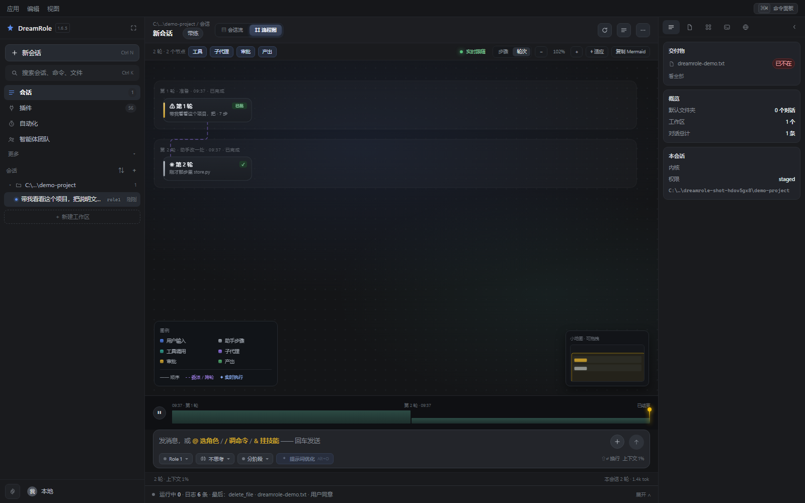

一步一个节点看得清细节，但四十步连成一条蛇之后，「它一共做了几轮、每轮大概干了什么」
反而看不出来。工具条上那两颗字切换的是**同一份数据的两种画法**，不是两次计算：
原始卡片一直留着，来回切不会越收越少。

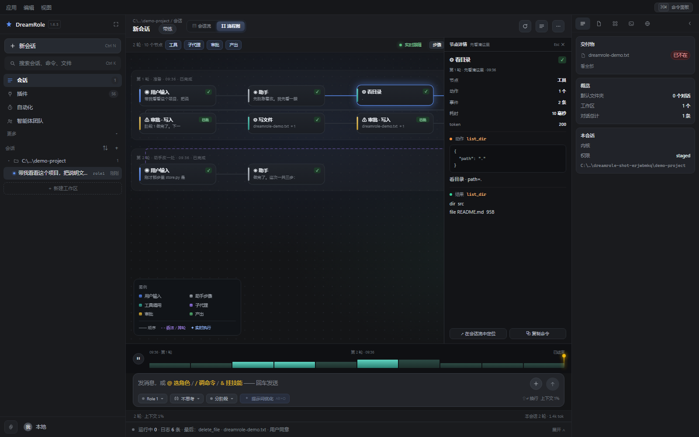

### 抽屉里的那两行：耗时和 token

| 行 | 怎么来的 | 没有的时候 |
|---|---|---|
| 耗时 | 这张卡里第一条和最后一条事件的时间戳之差 | 只一条事件时写「—」 |
| token | 这次模型调用花掉的量，挂到它产生的那条动作 / 答复上 | 写「未记」 |

token 是**真账**，不是摊出来的：`session.emit` 里一次调用只让第一条动作或答复领走
这笔用量（思维链和系统提示不领，否则同一笔账记两遍）。一次调用只回了段思考、
既没调工具也没收尾的，那一笔会并进下一次；一轮结束时还悬着的，贴到这一轮
最后一步上。宁可写「未记」，也不按整轮总数除以步数 —— 那种数字看着体面，
但它会让「哪一步最贵」这个问题永远得到错答案。

抽屉盖住了右边那一列怎么办：打开卡片时如果它正好被挡住，镜头会让开一点 ——
**开了卡却看不见是哪张，等于没开**。

想让别人直接看到某一张卡：地址后面加 `?card=3`（第几张，从 0 数），打开就是那张。
`python scripts/shoot.py --graph --card=3` 就是这么截出来的 ——
「你看第 3 张卡」比「你点一下那个卡片」准确得多。

关于这套镜头，四个决定写在这里，因为改它的人很容易踩回去：

1. **镜头是 `viewBox`，不是缩放重排。** 以前的 zoom 会改 `width/height` 再整张重画，画面跳、滚动位置丢。现在只改 `viewBox`，DOM 结构一个字节都不动 —— 这才谈得上跟手。
2. **按 `id` 增删改，不重画整张图。** 每来一个事件就 `innerHTML = ''` 重建，会让所有卡片重新淡入一次，看着像抽搐。现在老卡原封不动，只有**新来的**那张有入场动画，连线用 `stroke-dashoffset` 从 1 走到 0「长出来」。
3. **补间按时间算，不按帧算。** `cam += d * 0.26` 这种写法在 144Hz 屏上会比 60Hz 快 2.4 倍，手感跟着显示器变。现在是「每 45ms 走完剩下距离的一半」，帧率无关。另外有个 900ms 的兜底：rAF 被挂起（后台标签页、无头浏览器）时直接落到终点 —— 停在半路比不动更糟，因为它看起来像卡死了。
4. **卡片高度是算出来的，不是量出来的。** 正文手动折行（汉字算两格），高度 = 表头 + 行数 × 行高 + 内边距。用 `foreignObject` 交给 CSS 虽然省事，但布局就得先量一遍 DOM —— 布局依赖测量，第一次渲染必然是错的。

背景那层点阵跟着镜头平移（只改 `transform`，合成器搬，不重绘）。它不跟着走的话，拖动时内容在动、纸不动，看着像画面在纸上滑。

新卡片跑到视野外时，镜头会自己追过去 —— 但只在**你最后一次动镜头 5 秒之后**才允许。你正在看别处的时候被镜头拽走，比看不到新卡片更烦。

同一份事件还能导出。点右上角「导出」，四种格式：

| 格式 | 适合 |
|---|---|
| Markdown | 贴进文档、PR 描述。带阶段小标题和过程图 |
| 单页 HTML | 双击就能看，不依赖这个软件。发给同事最省事 |
| Mermaid | 只有图，贴到任何支持它的地方 |
| 原始 JSON | 给程序读的，包含每条事件的完整字段 |

导出不是把 JSON 丢给你 —— 事件流是给机器看的（谁挂在谁下面、第几步、哪一列），
人要的是一份**能直接读**的东西。所以 `report.py` 单独做了一层投影。

---

## 管理一堆会话

会话多了，侧栏那点宽度装不下，所以有命令面板（`Ctrl+K`），一个输入框管三件事：

- **动作**：切模式、开面板、导出、重试、换目录；
- **会话**：按标题搜；
- **正文**：标题搜不到时，再翻每个会话的内容，命中处给一句上下文。

匹配用的是子序列（查询里每个字符按顺序出现就算命中，连续的给更高分）。
不引模糊匹配库：三十行写完，还不用处理中文分词那一堆坑。

另外有个「用量」面板，按天和按模式汇总 token。数据**直接从每个会话的轨迹里算**，
不另存一份账本 —— 另存就要保证两边一致，而历史上删掉的会话到底算不算，永远扯不清。

---

## 安全边界

四道，都是可枚举的，不是「相信模型不会乱来」：

1. **路径**：所有文件操作走 `ToolContext.resolve()`。落点必须在工作区或**这个会话授权过的目录**之内
   （`is_relative_to` 判定，最长前缀优先），并且落在**只读**授权目录里的写操作一样拒绝。
   最外头还有第 0 层：`rules.py` 的硬规则在权限之前就拦掉系统目录和私钥目录，不随档位放松；
2. **命令**：18 条正则拦 `rm -rf` / `format` / `del /f /s` 这类，另有一套 `RISKY` 用来标「要重点确认」；
3. **网络**：只允许 `http/https`，且域名解析后必须是公网地址，挡掉内网探测；
4. **删除**：一律走系统回收站（Windows 上是 `SHFileOperationW`）。**回收站失败不降级成 `os.remove`** —— 宁可删不掉，也不能绕过回收站。而且只允许删「本次会话自己写过的文件」或明确的垃圾文件。

---

## 上下文治理

对话变长必然撞上窗口上限。策略是三条：

1. **留尾巴**：最近 10 条完整保留（工具调用链不能截断，否则 API 直接 400）；
2. **压中间**：更早的历史交给模型压成结构化摘要，替换成一条 system 消息；
3. **保系统**：system prompt 永远不动。

压缩的切点**必须避开 `role == "tool"`** 开头的位置 —— 那意味着它对应的 assistant(tool_calls) 被压掉了，OpenAI 协议会直接拒。

模型摘要失败时退化成机械摘要（列出此前做过什么），不把上下文丢掉。

### 窗口多大：六档，默认「自动」

窗口以前是**按模型名猜**的（`deepseek` → 64K，`claude` → 200K，`gpt-4o` → 128K…）。
猜错的方向只有一个：猜大了接口直接 400，猜小了只是多压一次，所以宁可往小猜。
但这留下一个说不清的问题 —— 用户明明知道自己的模型是 200K，界面里却没有地方能说。

设置 →「上下文与记忆」里现在能选六档：**自动 / 32K / 64K / 128K / 200K / 1M**。
选了就以选的为准，`context_limit()` 第一件事就是查这个值。

这里有一个**不修它就等于没做**的坑：`should_compact()` 除了比例阈值（默认 72%），
还挂了一条绝对兜底 `used > COMPACT_TRIGGER_TOKENS`（40K）。也就是说用户选了 1M，
到 40K 照样压缩 —— 那个下拉框形同虚设。现在兜底只在「窗口是猜的」时才生效：

```python
explicit = str(config.get().get("context_window") or "").strip().lower() in WINDOW_PRESETS
return (not explicit) and used > COMPACT_TRIGGER_TOKENS
```

同一条规矩的另一半：压缩阈值也给了三档（60% / 72% / 85%）。
**只改窗口不改阈值，等于只改了分母** —— 真想「尽量少压缩」的人该调的是比例。

---

## 从哪来：三份逆向报告的取舍

这个项目是按三份逆向分析报告拼出来的，但**没有照抄任何一份**。

**从 WorkBuddy 拿的：**
模式 = 提示词 + 工具白名单的双重约束、四档权限判定表、技能「只列名字按需加载」、子代理隔离上下文、定时任务的不并发 + 不补跑、检查点回滚。

**丢掉 WorkBuddy 的：**
62 个工具、20 个子代理、11 个 IM 渠道、126 个特性开关、哈希链审计。这些是「给所有人做的产品」的成本，一个人用不上，维护它是纯负债。

**从 PromptOptimizer 拿的：**
模板是 `.md` 文件不是代码里的字符串、主链路固定五步、**假设模型会不听话**（清洗 + 校验 + warnings）、结构化对比评审。

**丢掉 PromptOptimizer 的：**
143 个模板、16 个文本适配器、多轮迭代、多方案并排。它的价值在「批量做提示词工程」，这里的使用场景是「按一下，看能不能说得更清楚」。

**从「我的agent」拿的：**
事件流是唯一真相、图是纯投影、三档断点、超时一律 skip、四道可枚举的安全边界、教学法的 10 条硬规矩。

**修掉它的一个真 bug：**
那个项目的 `emit_control()` 只在 `on_event` 非空时才发断点信号，而 `server.py` 建 Session 时从没传过 `on_event` —— 所有断点信号静默消失，前端永远等不到确认框。
DreamRole 里 `emit()` 一律遍历 `self.listeners` 广播。订阅是唯一出路，代码路径不分叉。

---

## 改它

**加一个工具**：写一个 `app/tools/xxx.py`，导出 `SCHEMAS` 和 `HANDLERS`（handler 签名 `(ctx, **kwargs)`），在 `app/tools/__init__.py` 的 `MODULES` 里加一行，在 `app/permissions.py` 里标个类别。

**加一个内置技能**：扔一个 `skills/名字/SKILL.md` 进去（会被打进包里，运行时只读）。
想让用户也能改，就放进 `%LOCALAPPDATA%\DreamRole\skills\`，或者直接用界面上那个「＋ 新建技能」。

**加一个模式**：`app/modes.py` 的 `MODES` 加一条 + `app/prompts/` 加一个 `.md`。

**加一个会话层工具**（不改文件、只改会话状态的那种）：`app/tools/__init__.py` 的 `VIRTUAL` 加名字 + `_EXTRA_SCHEMAS` 加 schema，然后在 `app/session.py` 的 `_run_virtual()` 里写处理逻辑。`set_stage`、`todo_write`、`subagent` 都是这么接的。

**加一种导出格式**：`app/report.py` 里加一个 `to_xxx()`，`app/server.py` 的 `export_session()` 里加一个分支。

**加一个面板**：`web/js/panels.js` 的 `BUILDERS` 加一条 + 写一个 `buildXxx(body)`，再到 `web/js/sidebar.js` 的 `SECTIONS` 里加一栏（带 `tab`），`web/index.html` 的图标栏补一个 `.railBtn`。

**加一个浮层**（像产物面板那样挂在右侧）：照 `web/js/artifacts.js` 写一个模块，`index.html` 里放一个 `<aside class="drawer hidden">`，在 `app.js` 的 `bind()` 里接按钮、在 `Esc` 那条链上加一句。

**改文案**：所有提示词都在 `app/prompts/*.md`、`app/promptopt/templates/*.md`，改完不用重打包（源码模式下 `modes.reload_prompts()` 就能生效）。

**加一个提示词优化模板**：`app/promptopt/templates/名字.md`，带 frontmatter 和 `{{original}}` `{{context_block}}` 两个占位符。

---

## 测试

```bash
python scripts/selftest.py    # 485 项：主循环 / 权限闸门 / 阶段断点 / 重试 / 分叉 / 工具边界 / 图投影 / 导出 / 记忆 / 专家 / 检查点 / 工作区与授权目录 / 产物 / 深度思考 / 安全三层 / 助理与群规则 / 第二三批工具 / 子代理 / 改动归属与级联删除 / 三级下钻与阶段退回 / 本机软件（含真启动一个窗口） / 技能两目录与增删与注入 / 技能开关（关掉就不进提示·不进 turn_block·skill_load 会说它关着·重建同名会自动打开） / 全局通行证（新会话抄一份·老会话不回头变·会话里能单独撤） / 并发会话 / 自动记忆（三档·去重·纯聊天不花钱） / 上下文窗口（六档·选了 1M 就不该在 40k 压） / 两套底层（登记·归一·建会话绑定·老会话退回 role1·切分与参数摘要·取消要真的 kill 子进程） / 停下（命令跑到一半两秒内真的停·输出写明被中止·停下的一轮不再起新命令·长命令每 2 秒报一次「还在跑」并带最后一句输出·cancel 的返回值如实·停下后门闩放开能接着聊） / 群聊真的接得上（别人的话在「我」眼里翻成 user·第二位看得见第一位·没补充就 [skip]·走几轮·分工进群提示·盖掉单干那套话术） / 回归（定时任务状态落盘·手动任务不被 tick 跑·任务的权限/内核/技能存得住·并发账本·换行与编码风格）
python scripts/test_http.py   # 315 项：所有 HTTP 接口 + 静态前端 + 页面回执 + 工作区约束 + 产物接口 + 助理/群聊/安全/运行时/通道 + 命令行通道 + 改动归属与级联删除 + 三级下钻 + 软件清单 + 提示词库 CRUD + 删除工作区（三护栏） + 自动化的运行记录 + 归档会话的默认值 + 技能 CRUD 与来源标记 + 技能开关（关掉/再开/翻面/不存在给 404/一键全开） + 全局通行证（新会话自动带上·标着来路·老会话不变·能单独撤·能一次清空） + 群成员可加可减（剩一个人时拒绝） + 群的轮次能被夹到上限·分工只记群里的成员 + 停下接口如实回答（没在跑时说 stopping=false·在跑时说 true·停完立刻能接着发） / 一个在跑另一个照样能发 / 设置里几个新字段（上下文窗口·自动记忆·内核·DSH 路径）能存能读还真的生效 / 会话列表里标着引擎
python scripts/test_mcp.py    # 20 项：MCP 的 stdio 与 HTTP 两种传输（含 SSE 响应）
python scripts/ui_check.py    # 406 项：在真浏览器里跑前端逻辑（@ 补全 / 卡片折叠 / 命令面板 / 待办 / 过程图泳道·节点类型·镜头与开关卡·工具条筛选·底部时间轴 / 工作区拦截 / 左栏导航带计数且每栏都画得出来 / 会话树的分组·计数·收起 / 对话页五层 / 产物面板 / 工具分组折叠 / 会话「⋯」菜单 / 改动三级下钻与当前阶段禁用态 / 工具开关与运行期错误带 / 归档会话能翻出来 / 助理·安全·运行三栏 / 群聊署名 / 技能面板与输入栏技能浮层 / 技能卡上的开关（点一下压暗·标签变「已关」·「用这个」点不动·浮层里不列它·全部打开能还原） / 团队页的成员移出与成员表（移出群 ≠ 删角色）·私聊头能删角色·右栏能打开屋子 / 设置页「默认权限」那一节 / 跑着也能新建对话 / 内核胶囊与两张卡的选择器 / 插件页三格·指标·换格 / 自动化页的卡片·四档筛选·弹窗建单 / 自动化编辑器（三段·三档触发互换格子·权限三档·挂技能 chip·底部三键）  / 流程图（悬停高亮上下游·双击跳会话流·拖时间轴回放·步骤/轮次两档粒度·耗时与 token 两行·复制命令） / 底部日志抽屉（折叠 34px·三个格·日志三色·级别与来源筛选·展开后输入区还在窗口里） / 心跳上了界面（跑多少秒·哪个工具·最后一句输出）·按下停下按钮变「正在停…」且点不动·这一轮收尾后两个状态都清干净 / 输入框上的 @ chip（三色·点 × 真的从句子里摘掉） / 自动化三 tab（运行记录·模板卡给表单填好提示词） / 「＋」菜单八项齐全且点开真有内容 / 删工作区要手打名字 / 中栏头（面包屑+标题）·右栏常驻卡片与只看某一类·收起能再打开 / 输入区一整块·三枚胶囊在框里·底部状态条不出窗口 / 选目录弹窗的规矩·路径缩写·通行证 / 设置页「上下文与记忆」三个下拉·改完保存真的落盘 / 建群表单（走几轮·每人分工·勾一个人就多一行·不选人不摆空行） / 团队页发消息不弹到会话页（状态条三态·「看过程 →」点了才走·新的一句就地长在房间里））
python scripts/click_check.py # 51 项：走 CDP 打**真实鼠标事件**（点卡片弹抽屉 / 再点收起 / 点空白收起 / 拖动不算点击 / 点「⋯」只开菜单不误开会话 / 悬停工作区行才露出「＋」「⋯」且点它不折叠 / 真点行下钻到产物与阶段 / 真点技能按钮与浮层里的某一项 / 真点工作区按钮、点最近用过直接定为工作区）
python scripts/shoot.py       # 截图（--graph / --card=3 / --gran=round / --chips / --tree / --section=memory / --fresh / --panel=usage / --artifacts / --live）
```

上面这些都不连真模型（`scripts/fake_llm.py` 顶上去），跑一次十几秒。

还有两套要人来配合的：

```bash
python scripts/pick_folder_check.py  # 8 项：真弹出系统选文件夹对话框，截图存 shots/system-picker.png，
                                     #      自己点掉它，然后检查工作区有没有真的换过去
python scripts/live_test.py          # 22 项：真 DeepSeek 跑读/写/规划/带练/优化/评审/多轮
python scripts/role2_check.py        # 18 项：真跑一轮 DeepSeek Harness（会花 token），
                                     #      加 --offline 则只验定位不花钱
```

`pick_folder_check.py` 会**开一个真实的模态对话框并把整个进程挂住**，所以它不在日常回归里：
它干的事是从页面点「浏览这台电脑…」，等到窗口标题是「选择工作区」的那个 `#32770`，
截图，然后替你点一下「选择文件夹」，再轮询前端 `state.project` 有没有变。
最后断言八条：弹窗打开 / 找到那个按钮 / 真的弹出了系统对话框 / 点得到「选择文件夹」/
工作区有值了 / 拿回来带盘符 / 弹窗自己关了 / 顶栏跟着变。

`live_test.py` 会把 token 花掉，所以也不放在日常回归里，改完跟模型相关的逻辑再跑一次。

### 为什么 `ui_check.py` 要在真浏览器里跑

`@` 补全的判据、卡片折叠的规则、命令面板的开合，它们的输入输出都和浏览器里的
真实对象有关（光标位置、querySelector）。在 Python 里复制一份规则去测，
测的是复制品，不是跑在用户机器上的那份。

### 为什么还要一个 `click_check.py`

**合成事件测不出「输入」这件事。** 过程图曾经踩过：`pointerdown` 时就 `setPointerCapture`，
浏览器会把随后的 `pointerup` 和 `click` 一起改派给 svg —— 卡片上的 click 永远收不到，
真机上「点卡片没反应」。而 `ui_check.py` 里用 `dispatchEvent(new MouseEvent('click'))`
直接往卡片上打事件，照样全绿：合成事件根本不会真的捕获指针。

所以另开一套走 Chrome DevTools Protocol 的 `Input.dispatchMouseEvent`，它和真鼠标
走同一条输入管线（命中测试、指针捕获、click 派发都一样）。里面还有一条断言直接盯住
「click 落在 `.gCard` 上而不是 svg」—— 谁再把手掌按回 `pointerdown` 捕获，这里立刻红。

做法是：页面自己加载 `web/js/uitest.js`（只在 `?uitest=1` 时加载，正常使用一个字节都不执行），
跑完把结论写进 `<html data-uitest="pass">`，脚本用无头浏览器 dump 出来读。

---

## 踩过的坑：`await` 之后 `event.currentTarget` 就是 null

```js
onclick: async (event) => {
  const next = !event.currentTarget.classList.contains('on');
  const res = await API.toggleTool(tool.name, next);   // ← 这里一过，事件就结束了
  if (!res.ok) return toast(res.error, 'bad');
  event.currentTarget.classList.toggle('on', next);    // ← null.classList → TypeError
}
```

`currentTarget` 是**派发期间**才有的值，事件回调返回（或被 await 让出）之后就被置空。
所以规则很简单：**在第一个 `await` 之前把节点抓出来**。

```js
onclick: async (event) => {
  const button = event.currentTarget;   // 先抓住
  const next = !button.classList.contains('on');
  ...
}
```

这个坑在 `web/js/` 里一共三处，其中工具开关和出站打码开关是 `await` 版本（会崩），
设置页那个 `autoOptimize` 是同步的（不会崩）。`ui_check.py` 现在有一条断言真点一下开关，
同时验「状态翻了」和「没有弹出报错误」—— 只验前者的话，这个 bug 依然会漏。

`click_check.py` 测不出这一类问题（它测的是命中与事件路由），`selftest.py` 更测不出（它是后端）。
**前端异步错误只有真浏览器能测出来。**

---

## 踩过的坑：改一行，整份文件都变了

这是同一个坑的两半，出现在 `Path.read_text()` / `Path.write_text()` 上。

**第一半是换行。** 读写默认走通用换行翻译：读的时候 `\r\n` → `\n`，写的时候
`\n` → `os.linesep`。在 Windows 上，一个 LF 仓库被 `edit_file` 改了一行，
整份文件变成 CRLF —— git 显示「每一行都改了」，review 时没人看得出真正变了哪儿。

**第二半是编码，而且更狠。** 按 UTF-8 硬读一个 GBK 文件，读到的是替换字符（`�`），
再写回去就是「锟斤拷」。换行错了还能 diff 出来，内容没了是看不出来的：

```
读：'��һ��\n�ڶ���\n'
写回：b'\xef\xbf\xbd\xef\xbf\xbd\xd2\xbb...'      ← 原文已经没了
```

所以有了 `app/textio.py`：读时先认编码、再统一成 `\n`；写时按**原来的**编码和
换行风格写回去；新文件用 UTF-8 + `\n`。四点值得记下来：

- **`gbk` 要认在 `gb18030` 前面。** gb18030 是全 Unicode 超集（连 emoji 都能编成
  四个字节），拿它当「写回用的编码」，就会出现「往 GBK 文件里塞了个 😀，写成功了，
  但记事本里是四个乱码字节」。认成 `gbk` 才能在该拒绝的时候拒绝；真正的 gb18030
  老文件会在 `gbk` 那步解码失败，落到第三个候选上，照样读得对。
- **认 UTF-8 要用增量解码器（`final=False`）。** 采样只读前 64KB，可能正好切断一个
  三字节汉字；严格解码会失败、于是误判成 GBK，写回去就真的坏一个字。
- **写不回去就明确失败，而且一个字节都不动。** 先 `encode()` 成字节、成功了才开文件；
  边写边编会在失败时留一个被截断的文件。
- **UTF-16 的换行要解码之后再数。** 按字节数 `\r\n` 永远是 0（每个字符中间夹着 0x00），
  于是「CRLF 的 UTF-16」会被判成 LF，改一行整份换行都变了。

回退类动作（`changes.revert` / `changes.restore` / `checkpoints.restore`）也必须走这一层：
否则「退回」会把内容退回去、把编码和换行留在被改坏的状态。

---

## 踩过的坑：接口默认值，和前端过滤是两个坑

「显示已归档」点下去没反应，第一反应是前端过滤写错了。实际是接口那边：

```python
@app.get("/api/traces")
def list_traces(project: str = "", archived: int = 0):    # ← 默认只回未归档的
    return _json(store.list_traces(project or None, include_archived=bool(archived)))
```

前端从来不传 `archived`，拿回来的数据里就没有归档会话 —— 过滤写得再对，也变不出不存在的东西。
这类 bug 的特征是**界面看起来像「功能没实现」，其实是「数据没请求」**：按钮、样式、事件都正常，
只有那一条查询参数在撒谎。

两个值得记下来的点：

- **默认值不统一，靠记忆一定会错。** `GET /api/traces` 默认 `archived=0`（只回未归档），
  而 `GET /api/changes` 默认 `include_dead=1`（失效记录也算上）。所以断言里把两件事分开写：
  默认拿不到它、带 `archived=1` 才拿得到 —— 而不是「列表里有它就说明修好了」。
- **空态说「有 N 条被藏起来了」，前提是数据里真有那 N 条。** 只请求可见数据，
  这句「全部 3 条会话都归档了」永远算成 0，于是退化成「还没有会话」—— 一个更糟的谎。
  现在列表一次拿全，开关只决定画不画。
- **自检要有归档的种子。** `ui_check.py` 的沙盒里专门造一条归档会话（`seed_archived`），
  否则「点开能看见」这条断言永远空转 —— 它验的是一个空集合里有没有元素。

---

## 踩过的坑：双击完全没反应，是 exe 被打了「低完整性」标记

这是目前遇到过的、最像代码坏掉、其实完全不是代码问题的一个。

**症状**：打包成功，双击 exe，什么也没发生 —— 没有窗口、没有报错、没有日志、
Windows 事件日志里连一条崩溃记录都没有。构建脚本自带的冒烟测试也一起红了。

**怎么定位的**（这一步比结论更值钱）：把**同一份字节**复制到 `%TEMP%` 再跑，
居然正常启动；放回 `dist\` 就死。既然字节一样，差异只可能来自文件属性：

```
icacls "dist\DreamRole.exe"
    Mandatory Label\Low Mandatory Level:(I)(NW)      ← 低完整性
icacls "%TEMP%\DreamRole-copy.exe"
    （没有这一行）                                     ← 普通
```

**原理**：Windows 有一条规则 —— 可执行文件带 Low 强制标签时，通过它启动的**进程也是 Low**。
Low 进程不能往中等完整性的位置写东西，而 onefile 的 exe 启动第一件事就是往
`%TEMP%\_MEIxxxx` 解包。解包被拒 → bootloader 静默退出 → 你看到的就是「双击没反应」。

**它是怎么来的**：不是 PyInstaller 干的，是从目录**继承**的。有些沙箱/体检工具会给整个
工作区打上 Low 标签（为了让受限进程能写文件），于是这个目录里新生成的 exe
一个不落地全带上了。项目代码、打包参数都完全正确。

**处理**：构建脚本在产物落地之后把它改回中等完整性
（`icacls <exe> /setintegritylevel Medium`，见 `build_exe.py` 的 `_strip_low_label`）。
手动诊断就两条命令：

```
icacls "dist\DreamRole.exe"                                  # 看有没有 Low Mandatory Level
icacls "dist\DreamRole.exe" /setintegritylevel Medium        # 有就去掉
```

同一类问题还有一半：**窗口程序没有 stdout**，所以启动阶段崩掉时什么都留不下。
现在 `desktop.py` 从第一个 import 之前就开始往 `%TEMP%\dreamrole-boot.log` 写路标
（用到了哪几个模块、进到哪一步、崩在哪一行），失败时还有弹窗和完整堆栈。
没有这两样，「双击没反应」只能靠猜。

---

## 踩过的坑：改完前端、重启之后，界面还是旧的

**症状**：改了 `app.js`，重启进程，浏览器里那个按钮还是没出现。`Ctrl+F5` 之后有了，
但下一次改又没了。这套东西是零构建的（没有 webpack、没有 hash 文件名），
一开始以为这就是代价。

**不是。** `StaticFiles` 只给 `ETag` 和 `Last-Modified`，不给 `Cache-Control`。
浏览器对「没有明确缓存指令」的文件用启发式缓存 —— 大致按 `(现在 - Last-Modified)` 的
10% 当新鲜期。一个刚改过的文件新鲜期是几秒，但只要进程起来过一会儿，
它就开始被静默复用。

对一个「用户双击 exe、然后就再也不管缓存」的桌面应用来说，这是致命的：
**用户升级完看到的可能还是上一个版本的界面**，而且没有任何提示。

处理是在中间件里给入口和静态资源加 `Cache-Control: no-store, must-revalidate`：

```python
@app.middleware("http")
async def _fresh_assets(request, call_next):
    response = await call_next(request)
    path = request.url.path
    if path == "/" or path.endswith((".html", ".htm", ".js", ".css")):
        response.headers["Cache-Control"] = "no-store, must-revalidate"
    return response
```

只对这几类下手，`/api/*` 本来就不该缓存，图片和字体反而应该缓存。

---

## 踩过的坑：测试连上了一个早就该关掉的浏览器

**症状**：`click_check.py` 报「输入栏没有技能按钮」。但同一个进程里
`fetch('/')` 拉下来的 HTML 里明明白白有 `skillBtn`，`document.querySelector('#skillBtn')`
却是 `null` —— **同一份代码，两个结论**。

一个页面的 HTML 和它的 DOM 不一致，只可能是另一件事：**这个页面不是我刚打开的那个**。

**根因**：上一轮的 `--headless=new` Edge 没被杀干净，还在监听着 9333。
这一轮的新浏览器发现端口被占，连上去之后连到的是**旧浏览器里的旧页面**。
更坏的是它不会报错 —— CDP 连上就是连上了。

`kill_tree()` 用 `taskkill /F /T` 连同子进程一起杀，但杀完之后端口不一定立刻释放；
而且如果杀之前那次是异常退出的，进程树可能已经断了，`taskkill` 找不到。

所以顺序是：先 `kill_tree`，再 `free_port`（用 `netstat -ano` 找出占着这个端口的 PID，
没有对应进程就直接杀），然后**每轮重建一个干净的 profile 目录**，
最后再 `Network.setCacheDisabled(cacheDisabled=True)` 关掉缓存。

四道一起上，看着像过度防御。但每一条单独去掉都会让测试变成随机数：
跑绿的可能是真的绿，也可能是连到了上一次那个没问题的页面。

---

## 已知边界

- **IM 渠道、云账号、办公窗口、插件市场没做。** WorkBuddy 里那些能力（企业微信/飞书/钉钉接入、
  OneID 登录、`workbuddy-editor-sdk-supervisor.exe` 托管 Office、zip 型插件市场、云计费）
  都绑着平台账号或独立的闭源进程。没有凭据的版本做了也只能是空按钮，
  所以选择不做 —— 而不是做一个点下去没反应的入口。
- **只对 Windows 做了验证。** 删文件走回收站、截屏、窗控、取前台窗口都是 Windows API，别的系统上会退化成「不支持」而不是崩溃。
- **MCP 只做了 tools。** 协议里还有 prompts 和 resources 两块，没接 —— 它们要配套的 UI（斜杠菜单、资源选择器），不是接个接口就完事。
- **不做多模态。** 图读不了，截图只能自己看。
- **子代理只读。** 能写文件的子代理要处理并发改同一文件、中途失败谁回滚，成本远大于收益。
- **群聊里不给工具。** 一轮讨论里四个人各写一遍文件，出事没人说得清是谁。群聊的产出是看法，
  要动手就单独聊。想让「一群助理一起改一个项目」成为现实，得先有文件级锁和多人改动的合并策略 —— 那是另一个工程量级。
- **助理没有跨会话的短期记忆。** 它记得的是「自己的屋子」和「自己的对话记录」，但不会自动把上周的结论带到今天 ——
  那要靠它自己的 `memory/` 目录，得明确让它记。
- **上下文压缩是「有损」的。** 压过之后模型看不到细节，只有摘要。所以它会在压缩时明确告诉你压了多少条。
- **教学模式的阶段推进是「催」出来的。** 提示词写了「一个阶段只解决一个小问题」，但实测 DeepSeek 会一个阶段干完所有事然后总结。代码里会在它提前收尾时把总结打回一次（最多两次），逼它开下一个阶段。这是补偿，不是根治 —— 换更强的模型就不太需要它。
- **桌面壳依赖 WebView2，而它并不是永远可靠。** 开发机上见过它时好时坏：有时页面正常、有时连脚本都不执行，窗口里只剩背景色。这不是本项目能修的（同一台机器上 Edge 打开同一个地址一切正常），所以做了页面回执 + 浏览器窗口兜底：壳不行就换条路，用户总能看到界面，代价是那种情况下没有独立的原生窗口。
  见过的一种具体情形：WebView2 运行时在后台自动更新完、还没重启的时候，**任何** pywebview 窗口都起不来。
  为了不把这件事误判成「代码坏了」，`build_exe.py` 在跑窗口冒烟之前先用三行 pywebview 开一个只有 `<h1>ok</h1>` 的空白窗 ——
  连它都失败，就说明是这台机器的运行时有问题，脚本会明确写「跳过窗口冒烟：本机的 WebView2 现在起不来」，
  而不是丢一句「窗口没起来」让人去翻自己刚改的代码。
- **窗口程序的 stdout 是 `None`。** 没有控制台时 `sys.stdout` 是 `None`，而 uvicorn 配日志时会对 `sys.stdout.isatty()` 求值 —— 直接抛 `AttributeError`，服务起不来，用户看到的是「双击没反应」。`desktop.py` 在启动最前面给这两个流兜了底（写进 `logs/console.log`），这是必须的，不是保险。
- **安装包和 exe 都没有代码签名。** 所以第一次双击时 Windows SmartScreen 会拦一下，要点「更多信息 → 仍要运行」。签名要买证书（一年几百到几千），自用不划算。副作用是杀毒软件也可能对「刚下载的、没签名的、会起本地服务的 exe」多看一眼 —— 如果有人报「双击没反应」，先看是不是被当成可疑文件隔离了。
- **同一时间开两个实例，它们会各占一个端口、共用同一个数据目录。** 端口是自动往上找空闲的（8760 起），所以不会撞；数据目录共用的后果是两个人同时改同一条会话时会互相覆盖。要根治得加单实例锁，现在没做。
